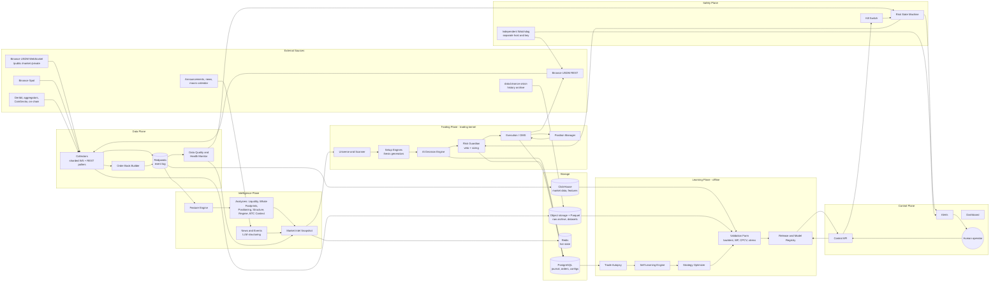
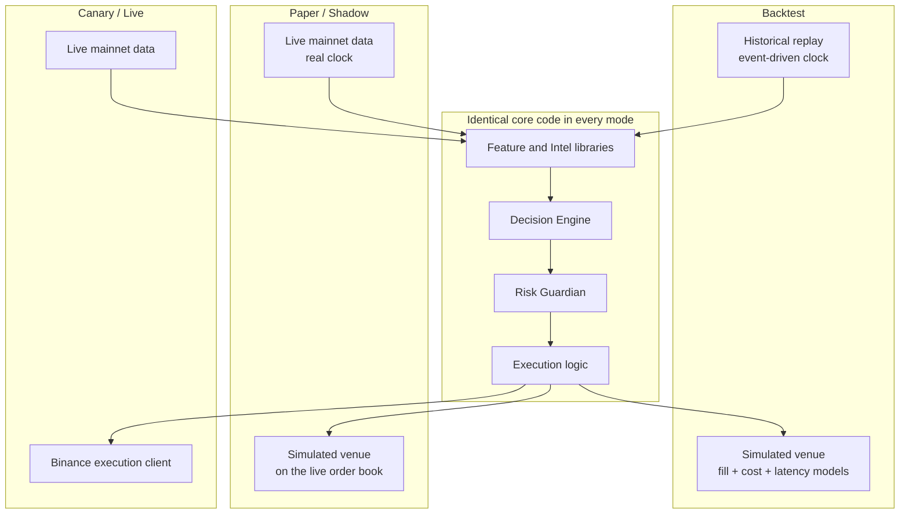
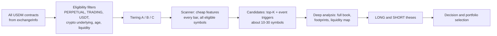
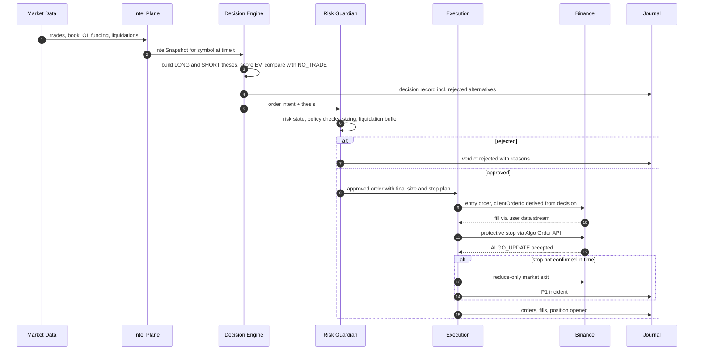

# 01 — البنية المعمارية للنظام

## 1. الصورة الكلية: ستة مستويات (Planes) بفصل صارم للمسؤوليات

| المستوى | المسؤولية | يعمل | يستطيع أن يغيّر |
|---|---|---|---|
| **Data Plane** | جمع البيانات وتطبيعها وبناء الدفاتر وقياس جودتها وتسجيلها خاماً | لحظياً | لا شيء خارج بياناته |
| **Intelligence Plane** | تحويل البيانات إلى ميزات وتحليلات: سيولة، بصمات، تموضع، نظام سوق، ارتباط، أخبار | لحظياً | لا شيء؛ ينشر "لقطات استخبارات السوق" فقط |
| **Trading Plane** | الكون والماسح، توليد الأطروحات، القرار، المخاطر قبل التداول، التنفيذ، إدارة المراكز | لحظياً | أوامر ضمن ما يقرّه Risk Guardian فقط |
| **Safety Plane** | آلة حالات المخاطر، مفتاح الإيقاف، الحارس المستقل | لحظياً | يستطيع **تقليل** المخاطرة فقط (إيقاف/إغلاق)، لا فتح صفقات |
| **Learning Plane** | تشريح الصفقات، التعلم، التحسين، التحقق، سجل الإصدارات | دُفعات (offline) | يقترح إصدارات مرشحة فقط؛ لا يكتب أبداً في سياسة المخاطر ولا يفعّل إصداراً على رأس مال حقيقي |
| **Control Plane** | واجهة الإنسان: لوحة، تنبيهات، موافقات، مفتاح إيقاف يدوي | عند الطلب | ما يأذن به الإنسان وفق الحوكمة |



## 2. لماذا هذا التقسيم؟

1. **اتجاه الصلاحيات أحادي**: البيانات ← التحليل ← القرار ← المخاطر ← التنفيذ. لا يستطيع مستوى أدنى أن يتجاوز مستوى أعلى، ولا يستطيع "الذكاء" أن يتجاوز "المخاطر".
2. **التعلم معزول عن التشغيل اللحظي**: Learning Plane يعمل على نسخ من البيانات والسجل، وينتج **إصدارات مرشحة** فقط. التفعيل على رأس مال حقيقي يمر ببوابات + موافقة بشرية (انظر [09](09-learning-validation.md)).
3. **السلامة مستقلة عن الذكاء**: Safety Plane لا يعتمد على صحة نماذج التعلم الآلي؛ قواعده بسيطة وحتمية، والحارس يعمل على خادم آخر بكود منفصل.
4. **التحليل منفصل عن القرار**: Intelligence Plane ينتج حقائق ومقاييس واحتمالات موثقة الأصل؛ القرار يستهلكها. هذا يسمح باختبار كل محلل وحده وقياس قيمته التنبؤية قبل أن يُسمح له بالتأثير في القرار.

## 3. الخدمات (عمليات التشغيل) وسلوك الفشل

| الخدمة | المسؤولية | الأهمية | سلوك الفشل الآمن |
|---|---|---|---|
| `collector-um-market` (عدة نسخ مجزأة) | WS للصفقات والشموع والمصفوفات العامة + REST للإحصاءات | عالية | إعادة اتصال بتدوير بلا فجوات؛ إعلان DEGRADED/FAILED للمراقب |
| `collector-um-book` | WS للدفاتر + لقطات REST + بناء الدفاتر المحلية | عالية | عند فجوة تسلسل: الدفتر "غير صالح" حتى إعادة المزامنة؛ تُعطَّل ميزات الدفتر للرمز |
| `collector-spot`, `collector-ext` | السوق الفوري والمصادر الخارجية | متوسطة | الميزات المعتمدة عليها تُعلَّم "غير متاحة" |
| `dq-monitor` | تقييم الجودة والحيوية لكل مصدر/رمز | **حرجة** | غياب نبضه بحد ذاته = FAILED (dead-man switch) |
| `intel` | الميزات والمحللات ولقطات الاستخبارات | عالية | لقطة قديمة ← محرك القرار يتجاهل الرمز (NO_TRADE) |
| `news` | جمع الأخبار وهيكلتها بنموذج لغوي | متوسطة | "حالة أخبار غير معروفة" ← CAUTION داخل نوافذ الأحداث |
| `trader` (عقدة نواة التداول) | الماسح، الأطروحات، القرار، Risk Guardian، التنفيذ، إدارة المراكز | **حرجة** | عند الانهيار تبقى أوامر الوقف على المنصة؛ الحارس يتولى المراقبة؛ لا استئناف قبل المطابقة |
| `watchdog` (خادم منفصل) | سلامة مستقلة: مراكز بلا وقف، حدود قصوى، نبض المتداول | **حرجة** | غيابه ← `trader` يدخل REDUCE_ONLY (لا صفقات جديدة بلا حارس) |
| `control-api` + لوحة | تحكم بشري وموافقات | متوسطة | التداول يستمر؛ مفتاح الإيقاف متاح أيضاً عبر CLI وبوت التنبيهات وواجهة Binance |
| `pipelines` (Dagster) | ملء التاريخ، بناء الميزات، التدريب، التحقق، التقارير | منخفضة لحظياً | لا أثر على التداول الحي |
| مخازن البيانات | Redpanda، ClickHouse، PostgreSQL، Redis، تخزين الكائنات | عالية | تعذّر الكتابة في PostgreSQL ← لا صفقات جديدة (P13) |

## 4. أوضاع التشغيل وتطابق البيئات (Parity)

القاعدة: **الكود نفسه** للميزات والقرار والمخاطر ومنطق التنفيذ في كل الأوضاع. المتغير الوحيد ثلاثة منافذ (Ports): مصدر البيانات، الساعة، ومكان التنفيذ.



| الوضع | البيانات | التنفيذ | رأس المال | الغرض |
|---|---|---|---|---|
| RESEARCH | تاريخية (Parquet/ClickHouse) | لا يوجد (تحليل متجهي سريع) | لا | فرز الأفكار فقط — **لا يُعتمد عليه أبداً لترقية** |
| BACKTEST | إعادة تشغيل أحداث مسجلة | محاكي بنماذج تنفيذ وتكلفة واقعية | لا | تحقق عالي الدقة، Walk-Forward، اختبارات الضغط |
| PAPER (Shadow) | حية من Mainnet | محاكي على الدفتر الحي | لا | مقارنة Challenger بـ Champion في الزمن الحقيقي |
| CANARY | حية | Binance حقيقي | جزء صغير من ميزانية المخاطر | التحقق من التنفيذ الحقيقي والانزلاق |
| LIVE | حية | Binance حقيقي | ميزانية المخاطر المعتمدة | الإنتاج |

> **ملاحظة:** شبكة الاختبار (Testnet) تُستخدم لاختبار تكامل الأوامر وتدفقاتها فقط، لا لتقييم الأداء؛ سيولتها وأسعارها لا تمثل السوق الحقيقي.

## 5. قمع الكون: مراقبة كل الرموز دون إغراق المعالجة

مراقبة مئات العقود لحظياً بعمق كامل مكلفة؛ لذلك يعمل النظام كقمع من مرحلتين: فحص رخيص لكل الرموز، ثم تحليل عميق للمرشحين فقط.



- كل الرموز المؤهلة: صفقات + شموع + دفتر بدقة 500ms + إحصاءات العقود.
- المرشحون والمراكز المفتوحة: دفتر بدقة 100ms + أفضل عرض/طلب لحظي + تحليل بصمات كامل + تسجيل خام للدفتر.
- الترقية من "عادي" إلى "مركّز" تحدث مبكراً (مثلاً عند اقتراب السعر من تجمّع سيولة رئيسي) لإعطاء ميزات الدفتر وقت إحماء.

## 6. دورة القرار من الحدث إلى الصفقة



**محفّزات دورة القرار:** إغلاق شمعة (1m/5m) للمرشحين؛ أحداث مهمة (كنس سيولة، بصمة كبيرة، موجة تصفيات، خبر عالي الأثر)؛ مراجعة دورية للمراكز المفتوحة.

## 7. ميزانية الزمن

النظام ليس HFT. الأهداف التالية تكفي لآفاق الدقائق والساعات:

| المرحلة | الهدف (p99) |
|---|---|
| استلام رسالة ← تحديث الدفتر/الميزة اللحظية | < 50ms |
| حدث ← لقطة استخبارات محدثة (رمز مركّز) | < 250ms |
| لقطة ← قرار + حكم المخاطر | < 500ms |
| حكم المخاطر ← إرسال الأمر | < 100ms |
| تنفيذ الدخول ← تأكيد وقف الخسارة على المنصة | < 3s (وإلا خروج طارئ) |
| دورة الماسح لكل الرموز | ≤ 60s |

## 8. أنماط الفشل والاستجابة الآمنة

| السيناريو | الكشف | الاستجابة التلقائية |
|---|---|---|
| انقطاع WS لرمز | تقادم الرسائل مقابل المعدل المتوقع | الرمز ← REDUCE_ONLY؛ إعادة اتصال ومزامنة |
| فجوة تسلسل في الدفتر | فحص `pu`/`u` | الدفتر غير صالح، إعادة مزامنة، تعطيل ميزات الدفتر للرمز |
| انقطاع User Data Stream | فشل keepalive/صمت | **REDUCE_ONLY عام** + مطابقة REST دورية حتى العودة |
| انهيار `trader` | غياب النبض عند الحارس | الحارس يتحقق من وجود الإيقافات ويُنبّه؛ إعادة التشغيل تبدأ بالمطابقة قبل أي شيء |
| عطل/صيانة المنصة | أخطاء REST/WS، إعلانات | REDUCE_ONLY؛ الاعتماد على الإيقافات المسجلة على الخادم؛ لا حلقات محاولات إغلاق |
| انحراف الساعة | chrony + `GET /fapi/v1/time` | تحذير ثم REDUCE_ONLY فوق العتبة |
| اقتراب حدود معدل الطلبات | رؤوس `X-MBX-USED-WEIGHT-*` | خفض الاستطلاع منخفض الأولوية؛ حجز سعة لأوامر الحماية |
| سعر شاذ (bad tick) | تقاطع آخر صفقة/منتصف الدفتر/سعر العلامة | تجاهل وتعليم؛ لا يُستخدم في القرار |
| استثناء في نموذج | خطأ/قيم NaN | NO_TRADE للرموز المتأثرة (fail closed) |
| تعذّر الكتابة في PostgreSQL | فشل المعاملة | لا صفقات جديدة؛ الإجراءات الوقائية مستمرة |
| مركز غير معروف على المنصة | المطابقة الدورية | وضع وقف حماية فوراً + REDUCE_ONLY + تنبيه P1 |
| حلقة أوامر خارجة عن السيطرة (bug) | مراقب معدل الأوامر | مفتاح الإيقاف K1 + تنبيه |
| تشغيل نسختين من `trader` على الحساب نفسه | قفل قيادة (leader lock) | النسخة الثانية ترفض البدء |

## 9. عقود البيانات الأساسية (Contracts)

كل رسالة بين المستويات لها مخطط مُصدَّر الإصدار (Pydantic/msgspec) ويُسجَّل إصداره مع البيانات:

| العقد | المنتج | المستهلك | أهم الحقول |
|---|---|---|---|
| `MarketEvent` (Trade, BookDelta, MarkPrice, Liquidation, OI, Stats5m, Kline) | Data Plane | الكل | `symbol`, `event_ts`, `recv_ts`, `available_ts`, `source`, payload |
| `DataHealth` | dq-monitor | Risk State Machine، القرار | `scope`, `state` (OK/DEGRADED/FAILED), `score`, `reasons` |
| `IntelSnapshot` | intel | الماسح، القرار | ميزات، خريطة السيولة، بصمات حديثة، تموضع، نظام السوق، سياق BTC، أعلام الأخبار، جودة البيانات |
| `TradeThesis` | Setup Engines | Decision Engine | الاتجاه، الدخول، الإبطال، الأهداف، الأفق، الاحتمال، التكاليف، الأدلة والأدلة المضادة |
| `Decision` | Decision Engine | Risk Guardian، السجل | الإجراء، الأطروحة المختارة، البدائل المرفوضة وأسباب رفضها، التفسير |
| `RiskVerdict` | Risk Guardian | التنفيذ، السجل | موافقة/رفض، نتائج كل قاعدة، الحجم النهائي، خطة الوقف |
| `ExecutionReport` | التنفيذ | إدارة المراكز، السجل | حالة الأمر، التنفيذات، الرسوم، الانزلاق مقابل المتوقع |
| `PositionState` | Position Manager | المخاطر، الحارس، اللوحة | الكمية، متوسط الدخول، الوقف الحالي، المخاطرة المفتوحة، الأطروحة الأصلية |

## 10. هيكل المستودع المقترح (Monorepo)

```text
.
├── docs/                    # هذه الوثائق + سجل القرارات المعمارية (ADR)
├── config/                  # أمثلة الإعدادات؛ سياسة المخاطر الحية خارج المستودع وموقّعة
├── db/                      # مخططات PostgreSQL وClickHouse وترحيلاتها
├── packages/                # مكتبات نطاق مستقلة عن الإطار (framework-agnostic)
│   ├── wt_core/             # الأنواع، العقود، الساعة، المعرفات، الأرقام العشرية
│   ├── wt_data/             # الموصلات، المطبّعات، باني الدفتر، فحوص الجودة
│   ├── wt_features/         # تعريفات الميزات (مسار لحظي ودفعي بالكود نفسه)
│   ├── wt_intel/            # السيولة، البصمات، التموضع، الهيكل، النظام، الارتباط، الأخبار
│   ├── wt_decision/         # الكون، الماسح، عائلات الإعداد، تقييم الأطروحات، اختيار المحفظة
│   ├── wt_risk/             # سياسة المخاطر، Guardian، التحجيم، آلة الحالات
│   ├── wt_execution/        # تكتيكات التنفيذ وخطط الأوامر (مستقلة عن المنصة)
│   ├── wt_journal/          # السجل الإلحاقي وواجهاته
│   └── wt_learning/         # التوسيم، التدريب، التحقق (WF/CPCV/DSR/PBO)، الانحراف
├── services/                # عمليات قابلة للنشر
│   ├── collector/  intel/  news/  trader/  watchdog/  control_api/
├── pipelines/               # أصول Dagster: ملء التاريخ، الميزات، التدريب، التقارير
├── research/                # دفاتر بحث (لا تُستورد أبداً من كود الإنتاج)
├── infra/                   # docker compose، Grafana، قواعد Prometheus، النشر
└── tests/                   # وحدة، خصائص، تكامل، تكافؤ، فوضى (chaos)، أداء
```

**قواعد الاعتماد (تُفرض بأداة `import-linter` في CI):**

- `packages/*` لا تستورد `services/*` ولا أي إطار تداول؛ الإطار يُلفّ بمحولات رقيقة داخل `services/trader`.
- `wt_learning` لا يستورد أي كاتب لسياسة المخاطر أو للإصدارات الحية.
- `wt_risk` لا يعتمد على `wt_learning` ولا على أي نموذج تعلم آلي.
- `services/watchdog` لا يستورد أي حزمة من المشروع باستثناء `wt_core` (حد أدنى من الكود المشترك لتقليل الأعطال المشتركة).
- `research/` لا يُستورد من أي مكان.
