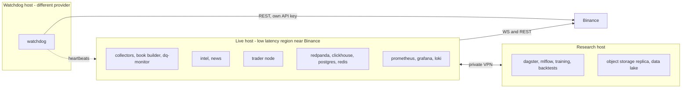

# 02 — التقنيات المختارة ومبرراتها

## 1. مبادئ الاختيار

1. **النضج قبل الحداثة**: أدوات مثبتة في الإنتاج، بإصدارات مثبّتة (pinned) وملفات قفل.
2. **تطابق البيئات أولاً**: أكبر سبب لفشل أنظمة التداول هو اختلاف سلوك الاختبار الرجعي عن الحي؛ نختار ما يقلّل هذا الفرق بالتصميم.
3. **لا نبني ما لا يمنحنا ميزة**: الميزة في الذكاء وإدارة المخاطر، لا في كتابة موصل منصة أو محرك مطابقة من الصفر.
4. **قابلية الاستبدال**: كل تقنية خلف واجهة (Port/Adapter) حتى يمكن تغييرها دون إعادة كتابة المنطق.

## 2. الجدول الرئيسي

| الطبقة | الاختيار | لماذا | بدائل رُفضت/مؤجلة |
|---|---|---|---|
| اللغة | **Python 3.12+** (والمتاح حالياً 3.13) | منظومة البيانات والتعلم الآلي والبحث الكمي الأغنى | Rust للمسارات الحرجة فقط إن أثبت القياس الحاجة (النواة المقترحة مكتوبة بـ Rust أصلاً) |
| نواة التداول (Trading Kernel) | **NautilusTrader 2.x** (إصدار مثبّت) خلف طبقة عزل | محرك أحداث حتمي بنواة Rust؛ الكود نفسه في Backtest/Sandbox/Live؛ موصل Binance USDT-M مُصان ويواكب تغييرات المنصة؛ OMS ومطابقة ودفاتر جاهزة | بناء نواة خاصة (تحكم أكبر ومخاطر أخطاء أكبر)، Freqtrade/Jesse (قائمة على الشموع والمؤشرات — تخالف المتطلبات)، Hummingbot (مخصص لصناعة السوق)، CCXT وحده (موصل بلا محرك اختبار ولا OMS) — انظر [ADR-001](12-adr-log.md) |
| موصلات منصة التسجيل | **كود خاص** async (`websockets`/`aiohttp` + `msgspec`/`orjson` + `uvloop`) | نحتاج تحكماً كاملاً بالتسجيل الخام والطوابع الزمنية وتدوير الاتصالات وتجزئتها لكل الرموز | — |
| ناقل الأحداث | **Redpanda** (واجهة Kafka) | سجل دائم قابل لإعادة التشغيل؛ عزل المنتجين عن المستهلكين؛ ClickHouse يستهلك منه مباشرة عبر محرك Kafka | NATS JetStream (أبسط، منظومة أضعف لهذا الاستخدام)، Kafka (تشغيل أثقل)، Redis Streams (غير كافٍ للأحجام الكبيرة) — [ADR-003](12-adr-log.md) |
| بيانات السوق والتحليلات | **ClickHouse** | ضغط وسرعة استعلام على مليارات الصفوف؛ Materialized Views لبناء الشموع | TimescaleDB (أبسط لكنه أثقل على مستوى الصفقات)، QuestDB — [ADR-002](12-adr-log.md) |
| سجل النظام (OLTP) | **PostgreSQL 16** | معاملات ACID للأوامر والسجل والإعدادات؛ أدوار وصلاحيات وRow-Level Security لفرض الحوكمة | — |
| الحالة الساخنة | **Redis 7** (أو Valkey) | آخر لقطات الاستخبارات، النبضات، الأقفال، عدادات المعدل | — |
| بحيرة البيانات | **MinIO/S3 + Parquet (zstd)** | أرشيف خام غير قابل للتعديل، مجموعات تدريب مُعنونة بالمحتوى، كتالوج بيانات النواة | — |
| استعلامات البحث | **DuckDB + Polars** | تحليل سريع مباشرة فوق Parquet دون خوادم | pandas حيث تلزم التوافقية فقط |
| الحوسبة العددية | NumPy، Numba | الحلقات الساخنة في الميزات | — |
| تعلم الآلة | **LightGBM** (أساسي)، scikit-learn (المعايرة: Isotonic/Platt، خطوط المعالجة)، MAPIE (التنبؤ المطابق Conformal)، SHAP (التفسير)، statsmodels/arch (التقلب)، hmmlearn (أنظمة السوق) | النماذج الشجرية المعززة الأقوى على البيانات الجدولية ذات الإشارة الضعيفة، وقابلة للتفسير | التعلم العميق (PyTorch) مؤجل للبحث على الدفاتر بعد إثبات الأساسيات |
| التحسين | **Optuna** | بحث فعّال، تسجيل كل التجارب (ضروري لحساب Deflated Sharpe) | Grid search (مُسرف ومُغرٍ بالإفراط في الملاءمة) |
| تتبع التجارب وسجل النماذج | **MLflow** | تتبع، سجل نماذج بأسماء مستعارة (champion/challenger)، تخزين القطع | W&B (خدمة خارجية) |
| تنسيق المهام الدفعية | **Dagster** | نموذج "الأصول" (datasets ← features ← models ← reports) مع نسب الأصل (lineage) | Prefect، cron |
| واجهة التحكم | **FastAPI + Pydantic v2** | عقود مكتوبة الأنواع، توثيق تلقائي | — |
| اللوحات | **Grafana** (مقاييس وسجلات) + واجهة داخلية خفيفة للقرارات والموافقات | Grafana للتشغيل؛ الواجهة الداخلية لعرض الأطروحات وخرائط السيولة والموافقات | — |
| المراقبة | **Prometheus + Alertmanager + Loki** (+ OpenTelemetry اختياري) | معيار صناعي | — |
| التنبيهات | Telegram bot (+ اتصال/رسالة للحالات P1) | فوري ومتاح على الهاتف؛ الأوامر عبره محدودة وموثّقة | — |
| الأسرار | **sops + age** (بداية) ← HashiCorp Vault لاحقاً | لا أسرار في Git؛ فك تشفير وقت التشغيل | ملفات `.env` غير مشفرة (مرفوضة) |
| البنية التحتية | Docker + Docker Compose (حتى الكناري)، Ansible للتهيئة | بساطة التشغيل لفريق صغير | Kubernetes عند الحاجة الفعلية فقط |
| مزامنة الوقت | **chrony** | الطوابع الزمنية الدقيقة شرط لصحة الميزات والطلبات الموقعة | — |
| الشبكة الخاصة | WireGuard/Tailscale | اللوحات وواجهة التحكم غير مكشوفة للإنترنت | — |
| جودة الكود | uv، ruff، mypy/pyright، pytest، hypothesis، pre-commit، import-linter | ملفات قفل، تحقق أنواع، اختبارات خصائص لقواعد المخاطر، فرض حدود الوحدات | — |
| CI/CD | GitHub Actions | فحص، اختبارات، اختبارات إعادة التشغيل، بناء صور موقعة | — |
| النموذج اللغوي (للأخبار والتقارير فقط) | **Claude عبر Anthropic API** — SDK بايثون الرسمي `anthropic`، أحدث نموذج من فئة Claude Opus (معرّفه قيمة إعداد) | هيكلة الأخبار بمخرجات منظمة مضمونة المخطط؛ كتابة ملخصات المراجعة | — (انظر §5) |

## 3. لماذا NautilusTrader، وما المخاطر؟

**لماذا:**

- تطابق البيئات بالتصميم: الاستراتيجية نفسها تعمل في الاختبار الرجعي، وفي التداول الورقي على بيانات حية (Sandbox)، وفي التداول الحي.
- موصل Binance مُصان: شهدت Binance تغييرين جذريين خلال 12 شهراً (نقل الأوامر الشرطية إلى Algo Service في ديسمبر 2025، وتقسيم WebSocket إلى `/public` و`/market` و`/private` مع إيقاف الروابط القديمة بعد 2026-04-23). صيانة موصل خاص لهذه التغييرات عبء دائم ومصدر أخطاء خطرة.
- محرك مطابقة على مستوى الدفتر للاختبار الرجعي، وطوابع زمنية بالنانوثانية، ومطابقة الحالة مع المنصة عند الإقلاع.

**المخاطر وكيف نحتويها:**

| الخطر | الاحتواء |
|---|---|
| انتقال الإطار من 1.x إلى 2.x (إصدارات مرشحة حتى سبتمبر 2026 على الأقل) وتغييرات كاسرة بين الإصدارات | تثبيت إصدار محدد؛ ترقية الإطار عبر خط الترقية نفسه (اختبارات تكافؤ وإعادة تشغيل)؛ لا ترقية أثناء تشغيل حي دون مرور بالورقي |
| الارتباط بالإطار (lock-in) | كل منطق النطاق في `packages/*` مستقل عن الإطار؛ الإطار يُلفّ بمحولات رقيقة؛ تكلفة الاستبدال محصورة في `services/trader` |
| فجوات في الموصل (مثل أنواع بيانات خاصة: OI، نسب L/S) | تُدخل كبيانات مخصصة (custom data) من خط بياناتنا؛ أي فجوة تنفيذية حرجة تُغلق بمساهمة أو محول خاص |
| منحنى التعلم | **Spike إلزامي لمدة أسبوعين في المرحلة 0** بمعايير قبول/رفض مكتوبة (انظر [11](11-roadmap.md)) |

إن فشل الـ Spike، يُبنى بديل بنواة خاصة وفق الواجهات نفسها (Ports) — المكتبات المستقلة عن الإطار تبقى كما هي.

## 4. طوبولوجيا النشر والعتاد المبدئي

| الخادم | المواصفات المبدئية (تُراجع بعد قياس المرحلة 1) | ملاحظات |
|---|---|---|
| الخادم الحي | 16 vCPU، 64GB RAM، NVMe 2TB، شبكة مستقرة | في منطقة منخفضة الكمون نحو خوادم Binance (يُقاس الكمون فعلياً قبل الاختيار)، وفي ولاية قضائية تسمح باستخدام المنصة |
| خادم الحارس | 1–2 vCPU، 2–4GB RAM | مزوّد/منطقة مختلفة لعزل أعطال البنية |
| خادم البحث | 16–32 نواة، 128GB RAM، GPU اختياري لاحقاً | التدريب والاختبارات الرجعية بعيداً عن الخادم الحي (عزل الموارد) |
| تخزين الكائنات | MinIO محلي + نسخة سحابية (S3) | الأرشيف الخام والنسخ الاحتياطية |

## 5. استخدام النموذج اللغوي (حدود صارمة)

**المسموح:**

- هيكلة الأخبار والإعلانات: تصنيف نوع الحدث، الأصول المعنية، الشدة، الحساسية الزمنية، تلميح الاتجاه، الثقة — بمخرجات منظمة (Structured Outputs) تتحقق من المخطط.
- كتابة ملخصات بشرية القراءة لتقارير المراجعة الأسبوعية من بيانات منظمة.
- مساعد بحث دون اتصال لتوليد فرضيات — وكل فرضية تمر بخط التحقق نفسه.

**الممنوع:**

- اتخاذ قرار تداول، أو تحديد حجم، أو تعديل أي إعداد، أو استدعاء أدوات.

**ضوابط هندسية:**

- SDK بايثون الرسمي `anthropic`، وأحدث نموذج من فئة Claude Opus ومعرّفه قيمة إعداد لا ثابت في الكود، مستوى جهد (effort) منخفض للتصنيف، تخزين مؤقت للموجّه الثابت (prompt caching)، وواجهة الدُفعات (Message Batches) لتوسيم الأرشيف التاريخي بتكلفة أقل.
- فحص `stop_reason` قبل قراءة المخرجات (بما فيه حالة الرفض) مع تفعيل البدائل من جهة الخادم.
- نص الأخبار مدخل **غير موثوق** (قد يحتوي حقن تعليمات): النموذج بلا أدوات، والمخرجات تُتحقق من المخطط، وأثرها **غير متماثل** — يمكن للأخبار تلقائياً أن **تمنع أو تقلّل** المخاطرة، ولا يمكنها وحدها **فتح** صفقة.
- قياس دقة التصنيف على مجموعة عناوين موسومة يدوياً قبل الاعتماد، وإعادة القياس عند تغيير النموذج أو الموجّه.
- اختيار نموذج أصغر وأرخص قرارك أنت، ويُتخذ فقط بعد تقييم مقارن على المجموعة الموسومة نفسها.

## 6. سياسة الإصدارات والاعتماديات

- كل الاعتماديات مثبّتة بملفات قفل مع بصمات (`uv.lock`)؛ صور الحاويات تُشار إليها بالـ digest لا بالوسم.
- تحديثات الاعتماديات تمر بـ CI كاملاً + اختبارات إعادة التشغيل الذهبية؛ تحديث النواة أو موصل المنصة يمر بخط الترقية كاملاً حتى الورقي.
- مسح أمني للصور والاعتماديات (Trivy، Dependabot).
