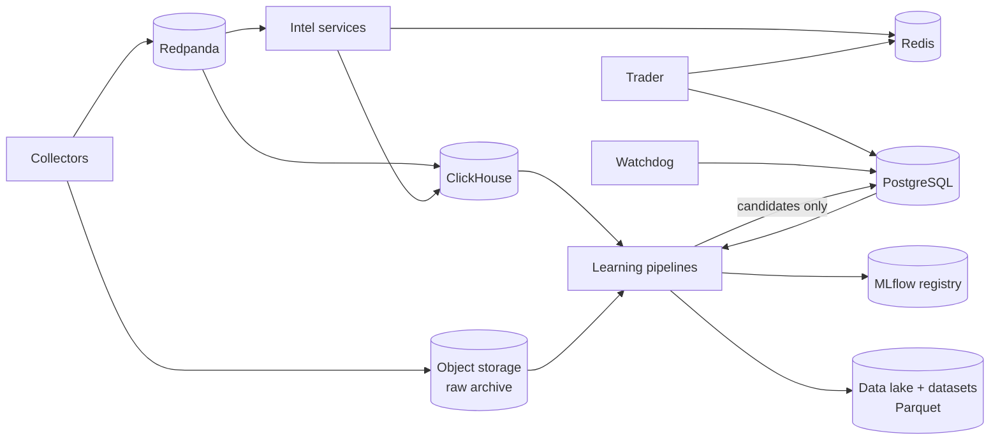

# 04 — قواعد البيانات والتخزين

## 1. توزيع الأدوار بين المخازن

| المخزن | الدور | لماذا هو بالذات | المخطط |
|---|---|---|---|
| **PostgreSQL 16** | سجل النظام (System of Record): البيانات المرجعية الزمنية، سياسة المخاطر، الإعدادات والإصدارات، سجل القرارات، الأوامر والتنفيذات والمراكز، أحداث المخاطر، بيانات التعلم الوصفية، سجل التدقيق | معاملات ACID، قيود سلامة، أدوار وصلاحيات وRLS **لفرض الحوكمة داخل قاعدة البيانات** | [`db/postgres/001_core_schema.sql`](../db/postgres/001_core_schema.sql) |
| **ClickHouse** | بيانات السوق عالية الحجم والميزات والبصمات ومستويات السيولة وجودة البيانات ولقطات مدخلات كل قرار | ضغط عالٍ وسرعة تحليل على مليارات الصفوف، وMaterialized Views لبناء الشموع | [`db/clickhouse/001_market_data.sql`](../db/clickhouse/001_market_data.sql) |
| **Redis** | الحالة الساخنة: آخر لقطات الاستخبارات، الدفاتر العلوية، النبضات، الأقفال، عدادات المعدل | زمن وصول أقل من الميلي ثانية؛ **ليس مصدراً للحقيقة** | §5 |
| **Object Storage + Parquet** | الأرشيف الخام غير القابل للتعديل، مرآة الأرشيف العام، بحيرة البيانات، مجموعات التدريب، قطع MLflow، التقارير | رخيص، غير محدود، قابل لإعادة التشغيل الحتمي | §6 |
| **Redpanda** | سجل الأحداث المتدفقة (احتفاظ أيام) | فصل المنتجين عن المستهلكين وإعادة تشغيل المستهلكين بعد الأعطال | [ADR-003](12-adr-log.md) |



## 2. PostgreSQL — المخططات

| المخطط | الجداول الرئيسية | ملاحظات التصميم |
|---|---|---|
| `ref` | `instruments`، `leverage_brackets`، `funding_config`، `universe_snapshots`، `correlation_clusters` | **SCD2**: لا يُستبدل تعريف عقد أبداً؛ تُغلق صلاحيته بـ `valid_to`. يسمح بإعادة بناء الكون والفلاتر كما كانت في أي لحظة (Point-in-Time) |
| `cfg` | `risk_policies`، `risk_policy_approvals`، العرض `effective_risk_policy`، `strategy_configs`، `release_bundles`، `release_stage_transitions`، `active_releases` | سياسة المخاطر **لا يكتبها إلا دور بشري**؛ تخفيف القيود لا يسري قبل 24 ساعة (قيد CHECK)؛ الإصدارات غير قابلة للتعديل وتنتقل بين المراحل عبر سجل انتقالات يفرض تسلسل البوابات |
| `trade` | `decision_cycles`، `theses`، `decisions`، `positions`، `position_events`، `orders`، `order_events`، `fills`، `funding_payments`، `account_snapshots`، `daily_pnl` | السجل إلحاقي؛ كل أمر دخول يجب أن يرتبط بقرار؛ أوامر الحماية يجب أن تكون reduce-only/close-position؛ الوقف لا يُوسَّع أبداً (Trigger) |
| `risk` | `verdicts`، `state_transitions`، `events`، `watchdog_actions` | الانتقالات الآلية لا تخرج من FLATTEN/HALTED (قيد + RLS)؛ الحارس يصعّد فقط |
| `analytics` | `trade_autopsies`، `thesis_outcomes` | نتائج **كل** الأطروحات، بما فيها المرفوضة (لتجنب انحياز الاختيار في التعلم) |
| `ml` | `dataset_snapshots`، `research_hypotheses`، `optimizer_studies`، `validation_reports`، `lockbox_access` | مجموعات بيانات معنونة بالمحتوى؛ تسجيل الفرضيات قبل اختبارها؛ عدد كل التجارب؛ استخدام صندوق الإقفال مرة واحدة لكل إصدار |
| `ops` | `data_health_incidents`، `audit_log` | كل تغيير بشري أو آلي على الإعدادات يُدقَّق |

### 2.1 الحوكمة مفروضة داخل قاعدة البيانات (ومُختبَرة)

| القاعدة | الآلية في المخطط |
|---|---|
| لا مكوّن آلي يكتب سياسة المخاطر (بل ولا يقرؤها خام) | لا صلاحيات لدور `wt_learning` على `cfg.risk_policies` |
| تخفيف القيود يحتاج 24 ساعة على الأقل | قيد `loosening_requires_cooldown` |
| المُحسِّن لا يستطيع دسّ مفاتيح مخاطر في معاملات الاستراتيجية | قيد `strategy_params_have_no_risk_keys` (خط دفاع ثانٍ بعد تحقق المخطط في التطبيق وCI) |
| لا قفز فوق بوابات التحقق — ولا حتى من إنسان | Trigger `apply_stage_transition` يسمح بالانتقالات القانونية فقط |
| الترقية إلى CANARY/CHAMPION بشرية فقط | قيد `human_required_for_capital` + سياسة RLS تمنع دور التعلم من ادعاء صفة HUMAN |
| تفعيل إصدار على LIVE/CANARY بشري فقط | RLS على `cfg.active_releases` (التعلم يقتصر على BACKTEST/PAPER) |
| الخروج من FLATTEN/HALTED بشري فقط | قيد `automatic_deescalation_limited` + RLS لكل دور |
| السجل لا يُعدَّل ولا يُحذف | لا صلاحيات UPDATE/DELETE + Triggers ترفض UPDATE/DELETE/TRUNCATE حتى من المالك |
| الوقف يُشدَّد فقط | Trigger `forbid_stop_widening` |

هذه القواعد مُختبرة آلياً: [`db/postgres/tests/governance_tests.sql`](../db/postgres/tests/governance_tests.sql) — **29 اختباراً ناجحاً** على PostgreSQL 16 أثناء التصميم (كل محاولة محظورة رُفضت، وكل عملية مشروعة قُبلت).

> الصلاحيات والقيود خط دفاع داخل قاعدة البيانات؛ وتبقى مكملة لا بديلة عن: التوقيع الرقمي لسياسة المخاطر، وعزل الشبكة والأسرار، ونسخ احتياطية غير قابلة للتعديل (WORM).

### 2.2 الأدوار

| الدور | يكتب | يقرأ | محظور عليه |
|---|---|---|---|
| `wt_collector` | `ref.*`، حوادث جودة البيانات | — | السجل، الإعدادات |
| `wt_trader` | السجل (`trade.*`، `risk.*`)، تحديث حالة الأوامر والمراكز | `ref`، `cfg` | سياسة المخاطر، الإصدارات، تعديل/حذف السجل |
| `wt_watchdog` | `risk.watchdog_actions`، تصعيد حالات المخاطر | `trade`، `risk`، السياسة الفعالة | التخفيف، أي إعداد |
| `wt_learning` | `analytics.*`، `ml.*`، **اقتراح** إعدادات وإصدارات، تشغيل Challenger ورقي | `ref`، `trade`، `risk`، الإصدارات | سياسة المخاطر (قراءة وكتابة)، الترقية لرأس مال، تفعيل LIVE |
| `wt_risk_admin` (بشري) | سياسة المخاطر وموافقاتها، إعادة الضبط من HALTED | الكل | — |
| `wt_release_admin` (بشري) | الترقية إلى CANARY/CHAMPION، تفعيل الإصدارات الحية، التراجع | الكل | — |
| `wt_readonly` | — | اللوحات | — |

## 3. ClickHouse — الجداول

| الجدول | المصدر | المحرك والتقسيم | الاحتفاظ |
|---|---|---|---|
| `md.agg_trades` | `@aggTrade` + الأرشيف | ReplacingMergeTree، شهري | دائم (أو 2–3 سنوات + الخام في التخزين) |
| `md.bars_1m` (+ MV) | يُبنى من الصفقات: OHLC، حجم شراء/بيع عدواني، عدد الصفقات، أكبر صفقة | AggregatingMergeTree | دائم |
| `md.klines_1m` | الشموع الرسمية لـ USDM والفوري (+ mark/index/premium) | ReplacingMergeTree | دائم |
| `md.book_snapshots_1s` | أعلى N مستوى كل ثانية للرموز المركّزة | MergeTree، يومي، TTL | 180 يوماً |
| `md.book_depth_bands` | عمق تراكمي ضمن نطاقات ± كل 5 ثوانٍ لكل الرموز | MergeTree | سنتان |
| `md.mark_price` (+ `mark_price_1m`) | `!markPrice@arr@1s` | MergeTree + تجميع دقيقة | الثانية 120 يوماً، الدقيقة دائماً |
| `md.funding_settlements` | تاريخ التمويل المستحق | ReplacingMergeTree | دائم |
| `md.open_interest` | الاستطلاع اللحظي | ReplacingMergeTree | دائم |
| `md.futures_stats_5m` | `/futures/data/*` + أرشيف `metrics` (المصدران جنباً إلى جنب) | ReplacingMergeTree | دائم |
| `md.liquidations` | `!forceOrder@arr` (**عيّنة**) | MergeTree | دائم |
| `intel.feature_vectors` | الميزات المحسوبة (live وreplay لاختبار التكافؤ) | MergeTree | دائم للإصدارات المعتمدة |
| `intel.footprint_events` | البصمات مع الثقة والتفسيرات البديلة | MergeTree | دائم |
| `intel.liquidity_levels` | كل رصد لمستوى سيولة وحالته (تاريخ كامل) | MergeTree | دائم |
| `intel.regimes` | نظام السوق العام ولكل رمز | MergeTree | دائم |
| `intel.data_quality_1m` | مقاييس الجودة بالدقيقة | MergeTree | دائم |
| `intel.decision_feature_snapshots` | المدخلات الدقيقة لكل قرار (للتدقيق وإعادة التشغيل) | MergeTree | دائم |
| `intel.news_events` | الأخبار المهيكلة | ReplacingMergeTree | دائم |

المخطط مُتحقَّق منه تنفيذياً أثناء التصميم (22/22 تعليمة على محرك ClickHouse مضمّن، مع اختبار دخان يبني شمعة دقيقة صحيحة من صفقات عبر الـ Materialized View).

## 4. تقديرات الأحجام (تُقاس فعلياً في المرحلة 1)

| البيانات | الحجم اليومي التقريبي | ملاحظة |
|---|---|---|
| الصفقات المجمّعة لكل الرموز | عشرات الملايين من الصفوف ≈ 0.5–2 GB مضغوطة | يتضاعف في أيام التقلب الحاد |
| تحديثات الدفتر الخام (100ms) لـ ~50 رمزاً مركّزاً | عشرات GB غير مضغوطة ≈ بضعة GB بعد zstd | **خام في تخزين الكائنات فقط** |
| لقطات الدفتر 1s للمركّزة | ~4 ملايين صف | ClickHouse بـ TTL |
| نطاقات العمق 5s لكل الرموز | ~8 ملايين صف | — |
| سعر العلامة 1s لكل الرموز | عشرات الملايين من الصفوف ≈ مئات MB | TTL + تجميع دقيقة |
| OI ونسب 5m | مئات الآلاف من الصفوف | صغير |
| سجل PostgreSQL | ميغابايتات | صغير جداً |

**خلاصة:** سنة كاملة ≈ بضعة TB في التخزين الخام وأقل من 1–2 TB في ClickHouse. مناسب لخادم واحد مع أرشفة سحابية.

## 5. Redis — المفاتيح

| المفتاح | المحتوى | TTL |
|---|---|---|
| `intel:snap:{symbol}` | آخر `IntelSnapshot` (مع `available_ts` وإصدار المخطط) | ثوانٍ (التقادم = عدم استخدام) |
| `book:top:{symbol}` | أفضل N مستوى | ثوانٍ |
| `health:{source}:{symbol}` | حالة الجودة | ثوانٍ |
| `hb:{service}` | نبض الخدمة | 3× فترة النبض |
| `lock:trader:{account}` | قفل القيادة — نسخة متداول واحدة فقط لكل حساب | قصير مع تجديد |
| `ratelimit:{ip}:{limiter}` | عدادات الوزن والأوامر | نافذة الحد |
| `risk:state:{scope}` | **نسخة للقراءة** من حالة المخاطر (المصدر: PostgreSQL + ذاكرة Guardian) | — |

## 6. تخزين الكائنات — التخطيط

```text
raw/binance-um/{stream}/date=YYYY-MM-DD/hour=HH/part-*.jsonl.zst   # الرسائل كما وصلت + recv_ts — غير قابلة للتعديل
raw/binance-spot/...
archive/binance-vision/futures/um/...                               # مرآة الأرشيف العام مع CHECKSUM
lake/{dataset}/v{n}/date=.../symbol=.../*.parquet                    # بيانات منقحة مُصدَّرة الإصدار
catalog/kernel/...                                                   # كتالوج بيانات نواة التداول للاختبار الرجعي
datasets/{dataset_id}/...                                            # لقطات تدريب معنونة بالمحتوى (لا تُعدَّل)
mlflow/...                                                           # قطع النماذج
reports/{release_id}/...                                             # تقارير التحقق
backups/postgres|clickhouse/...                                      # نسخ احتياطية (قفل كائنات/WORM)
```

## 7. قابلية إعادة الإنتاج ونسب الأصل

- كل مجموعة تدريب = بيان (manifest) يحدد الرموز والفترة وإصدار الميزات وإصدار التوسيم وقواعد as-of، ومعرّفها = بصمة SHA256 للبيان والمحتوى.
- كل إصدار (`release_bundle`) يشير إلى: Git SHA، digest صورة الحاوية، إصدار النواة، إصدار الميزات، إعدادات الاستراتيجيات، إصدارات النماذج، بصمة سياسة المخاطر، ومجموعات التدريب.
- النتيجة: يمكن إعادة بناء أي قرار تاريخي بالضبط — بالبيانات التي رآها، والنموذج الذي استخدمه، والسياسة التي حكمته.

## 8. النسخ الاحتياطي والتعافي

| المكوّن | الطريقة | الهدف |
|---|---|---|
| PostgreSQL | أرشفة WAL مستمرة + نسخ أساسية (pgBackRest/WAL-G) إلى التخزين السحابي | استعادة لأي لحظة (PITR)؛ RPO ≈ دقائق |
| ClickHouse | `BACKUP` يومي إلى S3 | قابل لإعادة البناء أيضاً من الخام |
| الأرشيف الخام | تكرار إلى مزوّد سحابي ثانٍ مع قفل الكائنات | لا فقدان للبيانات التي لا تُستعاد |
| الإعدادات والسجلات | ضمن PostgreSQL + Git | — |
| **اختبار الاستعادة** | شهرياً على بيئة منفصلة، مع محضر | نسخة لم تُختبر استعادتها ليست نسخة |
