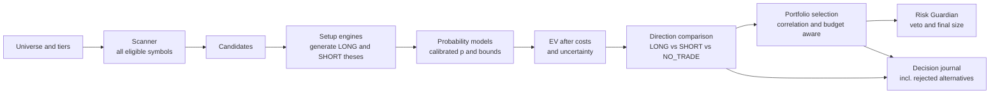

# 06 — محرك القرار (AI Decision Engine)

## 1. ما الذي يفعله المحرك، وما الذي لا يفعله

**يفعل:** يحوّل لقطات الاستخبارات إلى **أطروحات صفقات** لكلا الاتجاهين، ويقدّر لكل أطروحة احتمالاً معايَراً وعائداً وتكلفة وعدم يقين، ويقارن LONG وSHORT و"عدم التداول"، ويختار على مستوى المحفظة، ويسجّل كل شيء بما فيه البدائل المرفوضة.

**لا يفعل:** لا يحدد الحجم النهائي (Risk Guardian يفعل)، ولا يرسل أوامر، ولا يتجاوز أي قاعدة مخاطر، ولا يعدّل إعداداته بنفسه.



## 2. الكون والتصنيف (Universe & Tiering)

**الأهلية (تُحسب دورياً وعند `!contractInfo`):** `contractType = PERPETUAL`، `status = TRADING`، الهامش USDT، أصل أساسي من فئة العملات المشفرة (العقود على أصول تقليدية مستبعدة افتراضياً)، عمر إدراج ≥ الحد الأدنى في السياسة، سيولة وسبريد وعمق ضمن حدود الفئة، لا إعلان شطب، لا تعليق.

| الفئة | الوصف | التداول |
|---|---|---|
| A | سيولة عميقة جداً (مثل BTC وETH وقلة من الكبار) | نعم |
| B | عملات بديلة سائلة | نعم، بحدود انزلاق أشد |
| C | سيولة هامشية | تحليل فقط |
| X | غير مؤهل | لا |

لقطات الكون محفوظة زمنياً (`ref.universe_snapshots`) حتى تستخدم الاختبارات الرجعية الكون كما كان — بما فيه الرموز التي شُطبت لاحقاً.

## 3. الماسح (Scanner)

يعمل على كل الرموز المؤهلة عند كل شمعة (1m)، بميزات رخيصة الحساب:

- شذوذ الحجم (z)، توسع المدى، القرب من تجمعات سيولة مهمة (من الخرائط اليومية)، شذوذ تغير OI، تطرف التمويل، دفقات التصفيات، تغير ترتيب القوة النسبية مقابل BTC، عدد الصفقات الكبيرة.
- الناتج: درجة ترشيح. **المرشحون** = أعلى K + أي رمز ظهر عليه محفّز حدثي.
- الرموز التي تقترب من مستوى رئيسي تُرقّى مبكراً إلى "مركّز" (دفتر 100ms) حتى تتوفر ميزات الدفتر قبل لحظة القرار (وقت إحماء).

## 4. عائلات الإعداد (Setup Families) — فرضيات لا استراتيجيات مضمونة

كل عائلة **فرضية بحثية** لها مولّد أطروحات، ومنطق إبطال، ونموذج احتمال خاص بها (Meta-model). **لا يُفترض أن أياً منها مربح**؛ كل عائلة تمر بخط التحقق والترقية منفردة، وتُقاس نتائجها منفصلة.

| العائلة | الفكرة | LONG مثالاً | SHORT مثالاً | أهم مصادر الإبطال |
|---|---|---|---|---|
| S1 كنس واسترداد | بعد صيد الإيقافات يعود السعر إلى داخل النطاق | كنس قيعان متساوية ثم إغلاق فوقها مع امتصاص بيعي | كنس قمم ثم إغلاق تحتها | إغلاق مقبول خلف المستوى المكنوس |
| S2 اختراق مقبول | الاختراق الحقيقي يُكمل عندما يقبله السوق | اختراق قمة مع ارتفاع OI ومشاركة الفوري وصمود إعادة الاختبار | كسر قاع بالمواصفات المقابلة | عودة داخل المستوى (احتمال مصيدة مرتفع) |
| S3 ضغط التموضع المزدحم | الجهة المزدحمة تُجبر على الخروج عند محفّز | ازدحام بيعي + تمويل سالب متطرف + كسر هيكلي صاعد | ازدحام شرائي + تمويل موجب متطرف + تعثر السعر | استمرار الاتجاه رغم الازدحام |
| S4 ارتداد الاتجاه إلى القيمة/السيولة | في الاتجاه القوي تُشترى/تُباع الارتدادات عند مناطق القيمة | ارتداد إلى VWAP/HVN في اتجاه صاعد مع امتصاص | المقابل في اتجاه هابط | كسر هيكل الاتجاه (CHoCH) |
| S5 القوة النسبية مقابل BTC | العوائد المتبقية تستمر/ترتد بانتظام قابل للقياس | أقوى العملات في سوق BTC صاعد | أضعفها في سوق هابط | انقلاب النظام العام |
| S6 إنهاك شلال التصفيات | بعد شلال تصفيات حاد قد يحدث ارتداد | نهاية شلال تصفيات شراء مع امتصاص | نهاية شلال تصفيات بيع | استمرار الشلال؛ **حجم صغير دائماً** |

مصنّف مصائد الاختراق ([05 §5.3](05-intelligence-modules.md#53-تحليل-السيولة-liquidity-analysis)) هو الحَكَم بين S1 وS2 على المستوى نفسه: الحدث الواحد لا يمكن أن يكون "كنساً" و"اختراقاً مقبولاً" معاً بثقة عالية.

## 5. أطروحة الصفقة (Trade Thesis)

```yaml
thesis_id: a1c4…
symbol: SOLUSDT
side: LONG
setup: sweep_reclaim@1.2.0
horizon_minutes: 240
entry_plan: {type: LIMIT_ZONE, zone: [182.70, 183.10], expiry_s: 900, tactic: PASSIVE_POST_ONLY}
invalidation:
  stop_price: 181.85            # خلف القاع المكنوس + هامش تقلب، بعيداً عن الرقم المستدير 182.00
  structural: ["close_5m_below:182.40"]
  time_stop_min: 240
targets:
  - {price: 186.20, fraction: 0.5, kind: HVN}
  - {price: 189.90, fraction: 0.5, kind: PDH_LIQUIDITY_POOL}
p_win: 0.47          # معايَر من نموذج العائلة
p_win_lower: 0.44    # حد متحفظ (تشتت المجموعة/التنبؤ المطابق)
reward_r: 2.10       # بعد الخروج الجزئي
loss_r: 1.05         # يشمل انزلاق الإيقاف المتوقع
cost_r: 0.09         # رسوم + انزلاق الدخول + التمويل المتوقع للأفق
ev_r: 0.34
ev_r_lower: 0.25
evidence:
  - "كنس قيعان متساوية عند 182.40 بعمق 0.6×ATR ثم إغلاق 5m فوقها"
  - "شدة تصفيات المراكز الطويلة (عيّنة) 4.1σ عند القاع"
  - "امتصاص: 3.2M$ بيع عدواني دون كسر 182.30 (ثقة 0.55؛ بدائل: مخزون صانع سوق، أمر جليدي)"
  - "OI انخفض 2.3% أثناء الكنس — قرينة احتمالية على خروج مراكز لا فتح بيع جديد"
counter_evidence:
  - "BTC في نطاق بلا اتجاه"
  - "الهدف الثاني يتطلب اختراق PDH"
```

## 6. التقييم: الاحتمال، العائد، التكلفة، عدم اليقين

لكل أطروحة:

```text
EV   = p      × W − (1 − p)      × L − C
EV⁻  = p_low  × W − (1 − p_low)  × L − C
```

حيث `W` = العائد بوحدات R بعد الخروج الجزئي، `L` = الخسارة عند الإيقاف بوحدات R (≥ 1، تشمل انزلاق الإيقاف المتوقع)، `C` = التكاليف بوحدات R (رسوم الدخول والخروج حسب احتمال maker/taker، انزلاق الدخول المتوقع لحجمنا، والتمويل المتوقع لأفق الاحتفاظ بإشارته حسب الجهة).

| المكوّن | المصدر |
|---|---|
| `p` | نموذج احتمال خاص بالعائلة (Meta-labeling: هل تبلغ الأطروحة هدفها قبل إيقافها خلال الأفق؟) — LightGBM + معايرة Isotonic |
| `p_low` | الحد الأدنى من تشتت مجموعة نماذج (Ensemble) أو التنبؤ المطابق (Conformal) |
| `W`, `L` | هندسة الأطروحة + توزيعات تجريبية لـ MFE/MAE وانزلاق الإيقاف لأطروحات مشابهة |
| `C` | الرسوم الفعلية من `commissionRate`، نموذج الانزلاق، التمويل المتوقع |

**القرار يُبنى على `EV⁻` لا على `EV`.** نموذج غير متأكد يُعاقَب تلقائياً.

تحقق من المثال أعلاه: `0.47×2.10 − 0.53×1.05 − 0.09 = 0.34`، و`0.44×2.10 − 0.56×1.05 − 0.09 = 0.25`.

## 7. المقارنة بين LONG وSHORT وعدم التداول

لكل رمز مرشح: أفضل أطروحة LONG (أعلى `EV⁻` عبر العائلات)، وأفضل أطروحة SHORT، وخيار `NO_TRADE` (قيمته 0).

| الحالة (θ = أرضية القيمة المتوقعة، Δ = هامش التفضيل) | القرار | السبب |
|---|---|---|
| `max(EV⁻_L, EV⁻_S) < θ` | **NO_TRADE** | لا ميزة كافية بعد التكاليف وعدم اليقين |
| `EV⁻_L ≥ θ` و`EV⁻_S < 0` | LONG (إن نجحت البوابات) | تفوق واضح |
| `EV⁻_S ≥ θ` و`EV⁻_L < 0` | SHORT (إن نجحت البوابات) | تفوق واضح |
| `EV⁻_L ≥ θ` و`EV⁻_S ≥ θ` | **NO_TRADE** ويُسجل "غموض" | النماذج ترى حركة لا اتجاهاً؛ تعارض الأطروحتين دليل على عدم اليقين |
| واحدة ≥ θ والأخرى في `[0, θ)` | الأعلى فقط إذا كان الفرق ≥ Δ، وإلا NO_TRADE | تفضيل هامشي لا يكفي |

**بوابات السياق بعد المقارنة:** توافق النظام العام ونظام الرمز مع العائلة، قفل حدث BTC، نوافذ الأخبار، جودة البيانات، تبريد إعادة الدخول بعد إيقاف على الرمز نفسه.

- `θ` و`Δ` معاملات استراتيجية يحسّنها المُحسِّن، **لكن لا يمكن أن تنخفض عن الأرضية** `decision_floors.min_ev_r_lower` في سياسة المخاطر.
- كل أطروحة خاسرة في المقارنة تُسجَّل مع سبب رفضها، وتُوسَم نتيجتها الافتراضية لاحقاً ([09](09-learning-validation.md)) — هكذا نعرف هل كانت المقارنة صائبة.

## 8. الاختيار على مستوى المحفظة

الأطروحات الناجحة من كل الرموز في الدورة نفسها تتنافس على ميزانية مخاطرة محدودة:

1. ترتيب حسب `EV⁻` لكل وحدة مخاطرة، مع عقوبة لطول الأفق (كفاءة استخدام رأس المال).
2. إضافة جشعة (Greedy): تُضاف أطروحة فقط إذا بقيت المخاطرة المفتوحة، والتعرض الإجمالي والصافي المعدّل ببيتا، وحد العنقود، وخسارة سيناريو الإجهاد — ضمن السياسة **بعد** إضافتها.
3. عقوبة الارتباط: أطروحة على عملة مرتبطة بشدة بمركز مفتوح في الاتجاه نفسه تحتاج `EV⁻` أعلى (هي في الحقيقة زيادة للرهان نفسه).
4. حد أقصى للدخولات الجديدة لكل ساعة (يمنع دفقات الدخول في لحظة واحدة).
5. **لا استبدال متسرّع:** لا يُغلق مركز قائم لصالح أطروحة جديدة إلا إذا تفوقت بهامش كبير بعد احتساب تكاليف الخروج والدخول.

## 9. إدارة المراكز والخروج

الإصدار الأول قائم على قواعد شفافة، والبحث في الخروج بالتعلم الآلي لاحق:

| سبب الخروج | القاعدة |
|---|---|
| الإيقاف | أمر وقف على المنصة (Algo Order) — دائماً موجود |
| الأهداف | خروج جزئي عند تجمعات السيولة المقابلة (أوامر limit مخفّضة فقط) |
| الإبطال الهيكلي | تحقق شرط إبطال (مثل إغلاق 5m خلف المستوى المكنوس) ← خروج حتى لو لم يُضرب الإيقاف |
| الإيقاف الزمني | الأطروحة لم تتحرك كما يُتوقع خلال الأفق ← خروج (الفكرة التي لا تعمل في وقتها غالباً لا تعمل) |
| انقلاب البصمات | ظهور بصمات قوية معاكسة بثقة عالية ← تشديد الوقف أو الخروج |
| حالة المخاطر | REDUCE_ONLY لا يغلق تلقائياً؛ FLATTEN يغلق |

- **الوقف يُشدَّد فقط ولا يوسَّع أبداً** (قاعدة في Risk Guardian + قيد في قاعدة البيانات).
- نقل الوقف إلى نقطة التعادل **معامل يُختبر** لا قاعدة مسلّمة؛ قد يقلل التوقع الرياضي بإيقاف صفقات رابحة مبكراً.
- الأطروحة الأصلية (الوقف، الأهداف، شروط الإبطال، الإيقاف الزمني) تُخزَّن مع المركز؛ هكذا يستطيع **أي إصدار** إدارة مركز فتحه إصدار سابق بأمان — شرط ضروري للتراجع بين الإصدارات.

## 10. السجل والتفسير

كل دورة قرار تُنتج سجلاً كاملاً قبل أي تنفيذ (P13: لا تسجيل = لا صفقة):

```json
{
  "decision_id": "7f3c…",
  "symbol": "SOLUSDT",
  "decided_at": "2026-11-23T14:05:00.412Z",
  "mode": "PAPER",
  "action": "OPEN_LONG",
  "chosen": {"thesis_id": "a1c4…", "setup": "sweep_reclaim@1.2.0", "ev_r_lower": 0.25},
  "alternatives": [
    {"thesis_id": "b2d9…", "side": "SHORT", "setup": "breakout_acceptance@1.0.3", "ev_r_lower": -0.12,
     "rejected_because": ["breakout_trap_p=0.71", "spot_cvd_not_confirming"]},
    {"action": "NO_TRADE", "ev_r": 0.0, "rejected_because": ["long_ev_lower_above_floor_by_margin"]}
  ],
  "explanation": {
    "top_contributions": [["sweep_depth_atr", 0.09], ["absorption_score", 0.07], ["oi_change_during_sweep", 0.05]],
    "context_gates": {"regime_fit": true, "btc_event_lock": false, "news_blackout": false}
  },
  "rationale": "كنس قيعان متساوية مع امتصاص بيعي وخروج مراكز؛ أطروحة البيع مرفوضة لارتفاع احتمال المصيدة",
  "release_id": "0.4.0",
  "risk_policy_sha256": "9c1e…"
}
```

- **مساهمات الميزات** (SHAP) لأهم K ميزة، ونتائج كل بوابة سياق.
- **التبرير النصي** يُولَّد من البيانات المنظمة بقوالب ثابتة (وقد يُصاغ بلغة طبيعية لاحقاً)، ولا يُستخدم النموذج اللغوي في اتخاذ القرار نفسه.
- **مدخلات القرار الدقيقة** (متجه الميزات واللقطة كاملة) تُحفظ في `intel.decision_feature_snapshots` لإعادة التشغيل والتدقيق.
