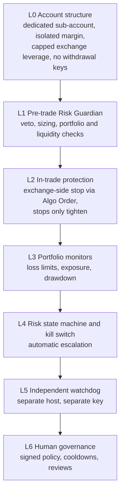
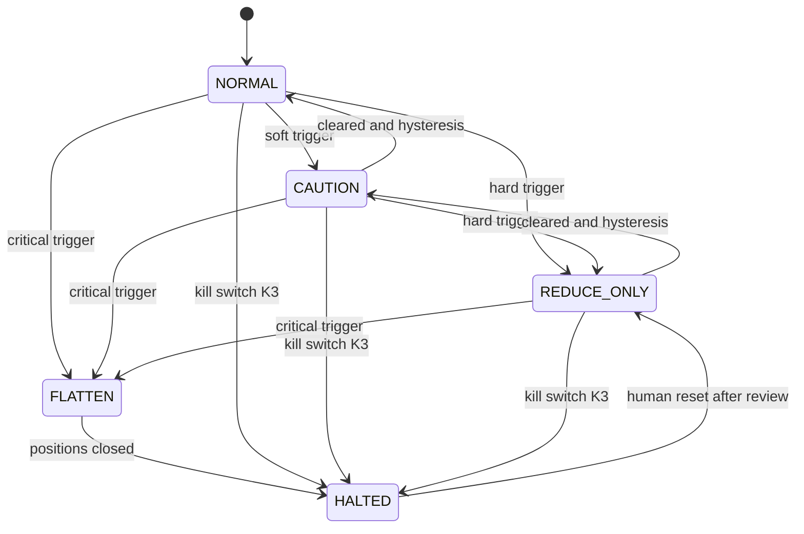

# 07 — إدارة المخاطر وحماية رأس المال

> هذه الوحدة هي قلب النظام. كل ما عداها قابل للتجربة والتعلم والتغيير؛ هذه الوحدة **لا تتغير آلياً أبداً**.
> القيم الرقمية أدناه مقترحات أولية متحفظة من [`config/risk-policy.example.yaml`](../config/risk-policy.example.yaml)؛ أنت من يحدد القيم النهائية حسب رأس مالك وتحمّلك.

## 1. طبقات الدفاع



كل طبقة تفترض أن الطبقات قبلها قد تفشل. الطبقة L2 (الوقف على المنصة) تحمي حتى لو انهار النظام بالكامل؛ والطبقة L5 تحمي حتى لو أخطأ المتداول نفسه.

## 2. هرمية القواعد

| النوع | أمثلة | من يغيّرها |
|---|---|---|
| **حدود صلبة (Hard)** | أقصى مخاطرة للصفقة، حدود الخسارة اليومية/الأسبوعية/الشهرية/من القمة، أقصى رافعة، الحد الأدنى لهامش التصفية، إلزامية الوقف على المنصة | **الإنسان فقط** عبر الحوكمة (§10) |
| **أرضيات القرار** | أدنى قيمة متوقعة متحفظة، أقصى نسبة تكلفة، أدنى عائد/مخاطرة | الإنسان؛ المُحسِّن يستطيع **رفعها** فقط |
| **مضاعفات ديناميكية** | الثقة، النظام، التراجع، جودة البيانات، حالة المخاطر | آلياً، لكن كل مضاعف ∈ [0, 1] — **تقليل فقط** |

```text
risk_pct_effective = min( risk_pct_target × m_confidence × m_regime × m_drawdown × m_data × m_state ,  risk_pct_max )
```

لا يوجد أي مسار رياضي أو برمجي يجعل `risk_pct_effective` يتجاوز `risk_pct_max`، ولا أي مسار يجعل مضاعفاً أكبر من 1 (يُختبر بخصائص — §11).

## 3. الحدود المقترحة (نقطة بداية للمراجعة)

| الفئة | الحد | القيمة المقترحة | الإجراء عند البلوغ |
|---|---|---|---|
| الصفقة | المخاطرة المستهدفة / القصوى | 0.25% / 0.50% من رأس المال | الحجم يُشتق منها |
| الصفقة | الخسارة تحت انزلاق إجهادي للوقف | ≤ 1.0% | رفض الصفقة |
| الصفقة | هامش التصفية | مسافة التصفية ≥ 3× مسافة الوقف | رفض أو تخفيض الرافعة |
| الحساب | رافعة المنصة لكل رمز | ≤ 5x، هامش معزول، وضع اتجاه واحد | الإقلاع يُرفض إن خالف الحساب |
| المحفظة | المراكز المفتوحة | ≤ 4 | رفض الجديد |
| المحفظة | المخاطرة المفتوحة الكلية | ≤ 1.5% | رفض الجديد |
| المحفظة | التعرض الإجمالي / الصافي المعدّل ببيتا | ≤ 2.0× / ≤ 1.5× رأس المال | رفض الجديد |
| المحفظة | لكل عنقود ارتباط | ≤ 2 مراكز و≤ 0.75% مخاطرة | رفض الجديد |
| المحفظة | سيناريو إجهاد (BTC −10%، ارتباط 0.9) | خسارة ≤ 4% | رفض الجديد |
| يومي | −1.0% / −1.5% / −2.5% | CAUTION / REDUCE_ONLY حتى اليوم التالي / FLATTEN ثم HALTED | تلقائي |
| أسبوعي | −4% | REDUCE_ONLY + مراجعة بشرية للاستئناف | تلقائي |
| شهري | −8% | HALTED | تلقائي |
| من القمة | −6% / −12% | خفض المخاطرة للنصف / HALTED ومراجعة حادثة إلزامية | تلقائي |
| سلسلة خسائر | 4 متتالية | تبريد 6 ساعات ثم نصف المخاطرة لـ 5 صفقات | تلقائي |
| الرمز | خسارتان في اليوم | حظر الرمز 24 ساعة | تلقائي |
| العائلة | −6R في آخر 20 صفقة | تعليق العائلة حتى المراجعة | تلقائي |

## 4. تحجيم المركز

```text
stop_distance   = |entry − stop| + expected_stop_slippage
qty_risk        = (equity × risk_pct_effective) / stop_distance
qty             = min(qty_risk, qty_liquidity_cap, qty_leverage_cap, qty_exposure_cap, qty_cluster_cap)
qty             = round_down(qty, stepSize);   reject if qty × price < minNotional
```

- **سقف السيولة:** الأمر ≤ 10% من العمق ضمن ±0.5%، والانزلاق المتوقع ضمن حد الفئة.
- **مسافة الوقف الصحية:** ≥ 4× السبريد و≥ 0.5× ATR(1m) (لتجنب الإيقاف بالضجيج)، و≤ 6% (وإلا فالأطروحة غالباً رديئة).
- **Kelly** يُستخدم فقط كمضاعف نسبي للثقة (كسر صغير منه)، ولا يتجاوز أبداً الحد الصلب.
- **فحص التصفية:** سعر التصفية يُحسب من شرائح هامش الصيانة الفعلية (`leverageBracket`)، ويجب أن يبعد ≥ 3× مسافة الوقف.
- **انزلاق الإيقاف الإجهادي:** في الشلالات تنزلق الإيقافات؛ الخسارة إذا انزلق الوقف بالافتراض الإجهادي للفئة (مثلاً 30 نقطة أساس لـ A و80 لـ B) يجب ألا تتجاوز 1%.

## 5. فحوص ما قبل التداول (بالترتيب، فشل أي فحص = رفض مع السبب)

1. حالة المخاطر تسمح بالدخول (عام/رمز/عائلة).
2. صحة البيانات: الرمز، BTC، User Data Stream، **نبض الحارس**، الساعة.
3. الكون: الرمز في فئة قابلة للتداول؛ لا إعلان شطب؛ لا نافذة حظر حدث.
4. اكتمال الأطروحة: وقف، أهداف، أفق، شروط إبطال؛ مسافة الوقف ضمن الحدود.
5. أرضيات القرار: `EV⁻` ≥ الأرضية؛ نسبة التكلفة ≤ الحد؛ العائد/المخاطرة ≥ الحد.
6. التمويل: لا دخول عكس تمويل متطرف.
7. التحجيم وتطبيق كل السقوف والتقريب.
8. هامش التصفية بالشرائح الفعلية.
9. المحفظة: المخاطرة المفتوحة، التعرض الإجمالي والصافي، العنقود، حصة الرمز، سيناريو الإجهاد — **بعد** إضافة الصفقة.
10. ضوابط التدفق: الدخولات في الساعة، تبريد إعادة الدخول، قاعدة سلسلة الخسائر.
11. نجاح كتابة القرار في السجل.

الناتج: `RiskVerdict` (موافقة بالحجم النهائي وخطة الوقف، أو رفض بقائمة الأسباب) يُسجَّل دائماً.

## 6. آلة حالات المخاطر



| الحالة | الدخول الجديد | المراكز القائمة | الخروج من الحالة |
|---|---|---|---|
| NORMAL | مسموح ضمن الحدود | إدارة عادية | — |
| CAUTION | مسموح بنصف المخاطرة، أرضيات أعلى، الفئة A/B فقط | إدارة عادية | آلياً بعد زوال السبب + مهلة 30 دقيقة |
| REDUCE_ONLY | **ممنوع** | إدارة وخروج فقط، تشديد الوقف مسموح | آلياً إلى CAUTION بعد زوال السبب + مهلة |
| FLATTEN | ممنوع | إغلاق منظم لكل المراكز (أوامر مخفّضة فقط) | آلياً إلى HALTED فقط |
| HALTED | ممنوع | لا شيء سوى الحماية | **يدوياً فقط** بعد مراجعة موثقة |

- الحالات تعمل على نطاقات: عام، ولكل رمز، ولكل عائلة إعداد. الحالة الفعالة = الأشد بين النطاقات.
- **التصعيد آلي فوراً**؛ التخفيف آلي فقط من CAUTION وREDUCE_ONLY بعد مهلة؛ من FLATTEN/HALTED يدوي فقط (مفروض أيضاً بقيد في قاعدة البيانات).
- **في الأحداث المتطرفة** (مثل هبوط BTC الحاد مع اتساع السبريد): REDUCE_ONLY والاعتماد على الإيقافات المسجلة على المنصة، **لا** إغلاق ذعري بأسعار السوق — الإغلاق القسري يُفعَّل بحدود الخسارة لا بالذعر.

## 7. مصفوفة الاستجابة لأعطال البيانات والبنية

| العطل | النطاق | الاستجابة |
|---|---|---|
| تقادم بيانات رمز (> 5s للمركّز) | الرمز | REDUCE_ONLY للرمز؛ التحقق من وجود وقفه على المنصة |
| دفتر غير صالح/إعادة مزامنة متكررة | الرمز | REDUCE_ONLY للرمز؛ تعطيل ميزات الدفتر |
| تعطل بيانات BTC | عام | REDUCE_ONLY عام (BTC يحكم السياق) |
| صمت User Data Stream مع مراكز مفتوحة | عام | REDUCE_ONLY فوراً + مطابقة REST كل بضع ثوانٍ حتى العودة |
| انحراف الساعة > 1000ms | عام | REDUCE_ONLY (الطلبات الموقعة قد تفشل) |
| غياب نبض الحارس | عام | REDUCE_ONLY (لا صفقات بلا حارس) |
| تعذّر الكتابة في PostgreSQL | عام | لا صفقات جديدة؛ الحماية مستمرة |
| رفض أوامر متكرر (> 5 خلال 10 دقائق) | عام | REDUCE_ONLY + تنبيه |
| اقتراب حدود المعدل | عام | خفض الاستطلاع؛ حجز 30% للحماية والخروج |
| مركز/أمر غير معروف | عام | وضع وقف حماية أولاً، ثم REDUCE_ONLY + P1 |
| صيانة/عطل المنصة | عام | REDUCE_ONLY؛ الاعتماد على الإيقافات المسجلة؛ لا حلقات محاولات |
| حالة أخبار غير معروفة داخل نافذة حدث | عام | CAUTION |
| نظام سوق UNKNOWN | عام/الرمز | CAUTION |

## 8. مفتاح الإيقاف الطارئ (Kill Switch)

| المستوى | الأثر | من يفعّله | الإلغاء |
|---|---|---|---|
| **K1** إيقاف الدخول | REDUCE_ONLY عام فوراً، إلغاء أوامر الدخول المعلقة | آلياً (مثل حلقة أوامر خارجة عن السيطرة) أو إنسان | آلياً وفق آلة الحالات، أو إنسان |
| **K2** إغلاق الكل | K1 + إغلاق كل المراكز بأوامر مخفّضة فقط، مع إبقاء الإيقافات حتى التسطح | حدود الخسارة الحرجة أو إنسان | إنسان فقط |
| **K3** توقف كامل | K2 + إيقاف خدمات التداول؛ الحماية والمراقبة فقط | إنسان (أو الحارس عند خرق حد صلب مستقل) | إنسان فقط بعد مراجعة |

القنوات: زر في اللوحة، أمر CLI، أمر بوت التنبيهات (موثّق بعامل ثانٍ)، وكحل أخير **واجهة Binance نفسها** (إغلاق يدوي) — موثّق في دليل التشغيل.

## 9. الحارس المستقل (Watchdog)

خدمة صغيرة **متعمَّدة البساطة**، على خادم ومزوّد مختلفين، بمفتاح API مختلف، ولا تعتمد على كود القرار أو التعلم.

| الفحص (كل 10 ثوانٍ) | الإجراء |
|---|---|
| مركز بلا وقف على المنصة لأكثر من 10 ثوانٍ | وضع وقف طارئ عند مستوى الأطروحة المسجل (أو أقرب مستوى آمن)؛ إن فشل ← إغلاق المركز |
| خسارة يومية ≥ 3% (حد مستقل أبعد قليلاً من حد المتداول) | إغلاق الكل + HALTED |
| تعرض إجمالي أو رافعة فوق الحد المستقل | تقليص |
| غياب نبض المتداول > 60 ثانية مع مراكز مفتوحة | التحقق من الإيقافات وتنبيه P1 |
| أوامر دخول معلقة بلا قرار معروف | إلغاؤها |

- **لا يفتح صفقات أبداً.** يصعّد حالات المخاطر فقط (مفروض بسياسة RLS في قاعدة البيانات).
- أولويته فوق المتداول: أي إجراء منه يُرى في User Data Stream ويجعل المتداول يدخل REDUCE_ONLY/HALTED.
- المتداول **لا يفتح صفقات جديدة** في غياب نبض الحارس.

## 10. حوكمة سياسة المخاطر (بلا أي تغيير آلي)

**العملية:**

1. الإنسان يعدّل ملف السياسة في مستودع/مجلد محمي منفصل عن كود النظام.
2. أداة توقيع (CLI) تعرض الفروق، وتصنّف كل تغيير "تشديد" أو "تخفيف" آلياً مع تأكيد بشري، وتطلب عاملاً ثانياً (TOTP)، ثم توقّع الملف بمفتاح المالك.
3. إدراج السياسة في `cfg.risk_policies` عبر الدور البشري `wt_risk_admin` مع سجل الموافقة.
4. **التشديد** يسري فوراً؛ **التخفيف** يسري بعد 24 ساعة على الأقل (قيد في قاعدة البيانات)، ولا يُسمح بأي تخفيف خلال 72 ساعة من توقف سببه الخسارة — حماية من قرارات ما بعد الخسارة الانفعالية.
5. Risk Guardian والحارس يحمّلان السياسة فقط إذا: صح التوقيع بالمفتاح العام المثبت محلياً، وطابقت البصمة السجل، وحلّ موعد السريان. ويعيدان بشكل مستقل حساب هل التغيير "تخفيف".
6. كل قرار يحمل بصمة السياسة التي حكمته؛ كل تغيير يُدقَّق ويُنبَّه عنه.

**الفرض التقني (دفاع متعدد الطبقات):**

| الآلية | ما تمنعه |
|---|---|
| التوقيع الرقمي بمفتاح بشري غير موجود على الخوادم | أي مكوّن آلي من إنتاج سياسة صالحة |
| أدوار قاعدة البيانات (لا صلاحية لدور التعلم على السياسة إطلاقاً) | الكتابة أو حتى القراءة من مكونات التعلم |
| مخطط إعدادات المُحسِّن يرفض أي مفتاح مخاطر + قيد CHECK في قاعدة البيانات + اختبار CI | تهريب حدود المخاطر كمعاملات استراتيجية |
| نوع `RiskPolicy` في الكود لا يُنشأ إلا من محمّل يتحقق من التوقيع | إنشاء سياسة في الذاكرة من مسار آخر |
| فترة التهدئة + منع التخفيف بعد التوقف | التخفيف المتسرع أو الانفعالي |

## 11. ثوابت للاختبار الآلي (Property-based tests)

| # | الثابت |
|---|---|
| I1 | لا يُرسل أمر `ENTRY` إلا مع `RiskVerdict` موافق لنفس القرار، وبحجم ≤ الحجم الموافق عليه |
| I2 | لكل مركز مفتوح وقف على المنصة خلال مهلة التأكيد، أو المركز قيد الإغلاق |
| I3 | `risk_pct_effective ≤ risk_pct_max` لكل المدخلات الممكنة (المضاعفات ∈ [0,1]) |
| I4 | الوقف لا يتحرك أبداً ضد المركز |
| I5 | لا انتقال آلي يخرج من FLATTEN/HALTED |
| I6 | لا مكوّن ينتج `RiskPolicy` إلا محمّل السياسة الموقّعة |
| I7 | مجموع المخاطرة المفتوحة ≤ الحد في كل لحظة، بما فيها بعد التنفيذات الجزئية |
| I8 | كل أمر حماية/خروج يحمل `reduceOnly` أو `closePosition` |
| I9 | فشل أي فحص يؤدي إلى رفض (fail closed) — الاستثناءات لا تتحول أبداً إلى موافقة |
| I10 | في غياب أي مدخل مطلوب (بيانات، نبض، سجل) تكون النتيجة رفضاً |
