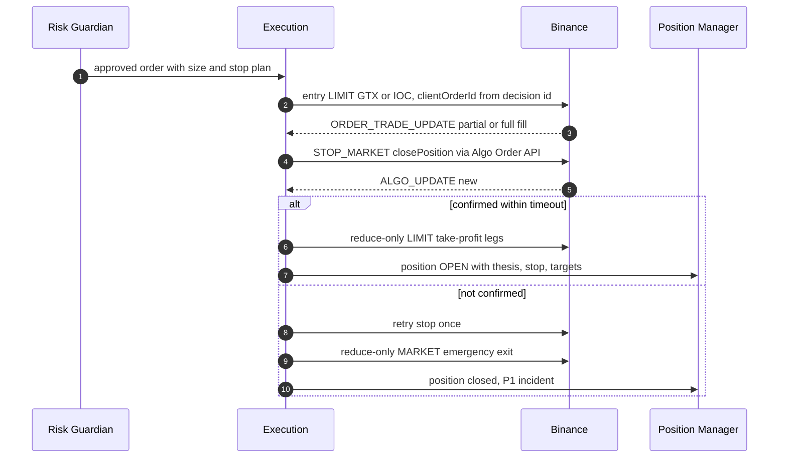

# 08 — التنفيذ وإدارة الأوامر (Execution & OMS)

## 1. تهيئة الحساب (يتحقق منها النظام عند كل إقلاع)

| الإعداد | القيمة | إن خالف الحساب |
|---|---|---|
| حساب فرعي مخصص | رأس مال المخاطرة فقط | — (قرار بشري) |
| وضع المراكز | One-way (`dualSidePosition = false`) | رفض الإقلاع |
| نوع الهامش لكل رمز | `ISOLATED` | ضبطه قبل أول صفقة؛ وإلا لا تداول على الرمز |
| الرافعة لكل رمز | ≤ حد السياسة | **خفضها** آلياً مسموح؛ رفعها آلياً ممنوع |
| Multi-Assets Mode | معطّل | رفض الإقلاع |
| مفتاح API | تداول فقط، **السحب معطّل**، قائمة IP بيضاء | رفض الإقلاع إن أمكن كشف المخالفة |

**لماذا اتجاه واحد وهامش معزول؟** الاتجاه الواحد يمنع مراكز LONG وSHORT متزامنة على الرمز نفسه (غالباً عديمة الجدوى ومكلفة)، ويبسّط المطابقة. الهامش المعزول يحصر الخسارة القصوى لكل مركز بهامشه، ومع قاعدة هامش التصفية (التصفية أبعد بـ 3× من الوقف) يُضرب الوقف قبل التصفية بفارق كبير.

## 2. أنواع الأوامر واستخداماتها

| الغرض | النوع | المسار | ملاحظات |
|---|---|---|---|
| دخول غير مستعجل | `LIMIT` + `timeInForce=GTX` (Post-only) | أوامر عادية | رسوم maker؛ قد لا يُنفذ. `timeInForce` قيمة واحدة فقط، فلا يُجمع GTX مع GTD: الإلغاء عند انتهاء صلاحية الأطروحة (`expiry_s`) يتم من طرفنا، والحارس يلغي أي أمر دخول متقادم |
| دخول بانتهاء على المنصة | `LIMIT` + `timeInForce=GTD` (`goodTillDate`) | أوامر عادية | عندما نريد أن تنتهي صلاحية الأمر على المنصة حتى لو تعطل نظامنا، دون شرط post-only |
| دخول مستعجل | `LIMIT` + `IOC` بسعر حماية أقصى | أوامر عادية | يحد الانزلاق؛ الجزء غير المنفذ يُلغى |
| وقف الخسارة | `STOP_MARKET` مع `closePosition=true` أو `reduceOnly`، و`workingType=MARK_PRICE`، و`priceProtect=TRUE` | **Algo Order API** (`POST /fapi/v1/algoOrder`) | منذ ديسمبر 2025 الأوامر الشرطية تمر حصراً عبر Algo Service؛ التأكيد عبر `ALGO_UPDATE` |
| الأهداف الجزئية | `LIMIT` + `reduceOnly` | أوامر عادية | رسوم maker عند الأهداف |
| هدف شرطي (اختياري) | `TAKE_PROFIT_MARKET` | Algo Order API | — |
| خروج إبطال/زمني | `LIMIT IOC` مخفّض فقط، ثم `MARKET` مخفّض فقط إن لزم | أوامر عادية | — |
| خروج طارئ / مفتاح الإيقاف | `MARKET` + `reduceOnly` | أوامر عادية | أولوية قصوى في ميزانية المعدل |

> **معاملات Algo Order (مؤكدة من كود Binance الرسمي):** `algoType=CONDITIONAL`، `type=STOP_MARKET`، سعر التفعيل اسمه **`triggerPrice`** (لا `stopPrice`)، والمعرّف الحتمي يُرسل في **`clientAlgoId`**، مع `closePosition`، `reduceOnly`، `workingType`، `priceProtect`، `goodTillDate` — التفاصيل في [تقييم المستودعات](research/repo-due-diligence-2026-11.md#ما-حسمه-كود-binance-الرسمي-كان-معلقا). حالات `ALGO_UPDATE` الكاملة تُختبر على بيئة Demo قبل كتابة كود التنفيذ.
>
> **ملاحظة حول `workingType`:** تفعيل الوقف بسعر العلامة يقلل الإيقاف بذيول آخر سعر المصطنعة، لكن سعر العلامة قد يتأخر في الحركات السريعة. الاختيار معامل يُقاس (انزلاق الوقف الفعلي ونسبة الإيقافات بالذيول) لا افتراض.

## 3. تسلسل الدخول ثم الحماية

- مع التنفيذ الجزئي: وقف `closePosition=true` يحمي أي كمية منفذة دون إعادة حسابه مع كل تنفيذ.
- إن ردّت المنصة بأن أمر الوقف "سيتفعل فوراً" (السعر تجاوز الوقف بالفعل) ← خروج فوري مخفّض.
- تعديل الوقف = وضع الوقف الجديد **أولاً** ثم إلغاء القديم (لا لحظة بلا حماية)، وفي اتجاه التشديد فقط.
- عند إغلاق المركز: إلغاء كل الأوامر المتبقية للرمز (العادية وAlgo) والتحقق من التسطح.

## 4. التكرار الآمن (Idempotency)

- `clientOrderId` حتمي = دالة(`decision_id`، الساق، رقم المحاولة) — إعادة المحاولة بعد مهلة شبكية لا تنشئ أمراً مكرراً، والاستعلام بالمعرّف يكشف هل وصل الأمر الأول.
- كل تغيير حالة أمر يُسجَّل حدثاً إلحاقياً (`trade.order_events`) مع الرسالة الخام.

## 5. المطابقة مع المنصة (Reconciliation)

| متى | ماذا |
|---|---|
| عند الإقلاع (قبل أي شيء) | المراكز، الأوامر العادية المفتوحة، أوامر Algo المفتوحة، الرصيد، إعدادات الحساب ← مقارنة بالحالة الداخلية |
| كل ~20 ثانية | المراكز والأوامر المفتوحة |
| بعد كل إعادة اتصال لـ User Data Stream | مطابقة كاملة قبل استئناف أي دخول |

| الاختلاف | الإجراء |
|---|---|
| مركز غير معروف | وضع وقف حماية فوراً ثم REDUCE_ONLY + P1 (احتمال تدخل يدوي أو خلل) |
| مركز معروف بلا وقف على المنصة | وضع الوقف فوراً؛ إن فشل ← إغلاق |
| أمر دخول معلق غير معروف | إلغاؤه + تنبيه |
| فرق كمية | الحقيقة = المنصة؛ تصحيح الحالة الداخلية + تحقيق |

قفل قيادة (leader lock) يضمن نسخة متداول واحدة فقط لكل حساب.

## 6. إدارة حدود المعدل بالأولويات

| الأولوية | النوع | السياسة |
|---|---|---|
| P0 | أوامر الحماية، الخروج الطارئ، مفتاح الإيقاف | لا تُحجب أبداً؛ سعة محجوزة (30%) |
| P1 | الخروج العادي، تعديل الوقف | قبل الدخول |
| P2 | الدخول الجديد | يُؤجَّل عند الضيق |
| P3 | استطلاع البيانات | أول ما يُخفَّض |

- دلاء رموز (Token buckets) لكل حد معلن في `exchangeInfo.rateLimits`، تُصحَّح من رؤوس الاستجابة (`X-MBX-USED-WEIGHT-*`، `X-MBX-ORDER-COUNT-*`).
- 429 ← تراجع فوري وخفض P3/P2؛ لا إعادة محاولة عمياء (تجنب حظر 418).

## 7. معالجة الأخطاء (أمثلة — الجدول الكامل يُبنى من الوثائق في المرحلة 0)

| الخطأ (مثال) | المعنى | الإجراء |
|---|---|---|
| انتهاء `recvWindow` / الطابع الزمني | انحراف ساعة | إعادة مزامنة الوقت؛ تصعيد إن تكرر |
| الهامش غير كافٍ | — | رفض الدخول؛ تحقيق في التحجيم |
| أمر Post-only كان سيُنفذ كـ taker | السعر تحرك | إعادة تسعير مرة أو التخلي عن الدخول |
| الأمر الشرطي سيتفعل فوراً | السعر تجاوز الوقف | خروج فوري مخفّض |
| نوع أمر غير مدعوم على هذا المسار | أمر شرطي أُرسل لمسار الأوامر العادية | **خطأ إعداد حرج** ← K1 + تنبيه |
| طلبات كثيرة | تجاوز المعدل | تراجع، خفض الأولويات الدنيا |

## 8. قياس جودة التنفيذ (TCA)

- **سعر الوصول** (منتصف الدفتر لحظة القرار) مقابل متوسط التنفيذ ← العجز التنفيذي (Implementation Shortfall).
- الانزلاق الفعلي مقابل المتوقع من النموذج لكل فئة ورمز وحجم؛ زمن القرار ← الإرسال ← التنفيذ؛ نسبة تنفيذ أوامر Post-only؛ انزلاق الإيقافات الفعلي.
- النتائج تعود إلى نموذج الانزلاق ونموذج التكلفة في الاختبار الرجعي — **إن كان الواقع أسوأ من النموذج، يُصحَّح النموذج لا الواقع**.

## 9. التنفيذ المحاكى (Backtest/Paper)

| العنصر | النموذج (متحفظ عمداً) |
|---|---|
| أوامر limit | تُنفذ فقط إذا **تداول السعر عبر** المستوى، أو عنده بحجم يتجاوز الطابور التقديري أمامنا |
| أوامر market/IOC | تمشي في الدفتر المسجل/الحي + عقوبة إضافية + كمون مُحقَن |
| الكمون | قرار ← أمر: 50–300ms (توزيع)، بيانات ← قرار: حسب التسجيل |
| الرسوم | الفعلية من `commissionRate` |
| التمويل | عند مواعيده الفعلية بالمعدلات التاريخية وبفترة كل رمز |
| الإيقافات | تنفيذ بأسوأ سعر واقعي بعد التفعيل + انزلاق إجهادي في الشلالات |
| قيود المنصة | tick/step/minNotional، شرائح الرافعة، نطاقات السعر |

## 10. شبكة الاختبار (Testnet)

تُستخدم **لاختبارات التكامل فقط**: إرسال/إلغاء الأوامر، أوامر Algo وأحداث `ALGO_UPDATE`، التنفيذات الجزئية، إعادة الاتصال، رموز الأخطاء. **لا تُستخدم لتقييم الأداء** — أسعارها وسيولتها لا تمثل السوق الحقيقي. توفر Binance بيئة **Demo Trading** (`demo-fapi.binance.com` / `demo-fstream.binance.com` بحسب موصل NautilusTrader — [SPIKE-001](spikes/SPIKE-001-trading-kernel.md)) إلى جانب Testnet القديمة؛ العناوين تُطابق مع الوثائق الرسمية قبل الاستخدام.
