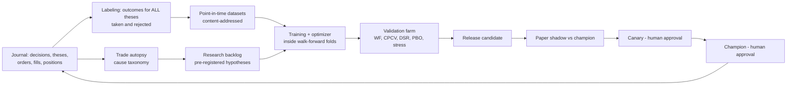
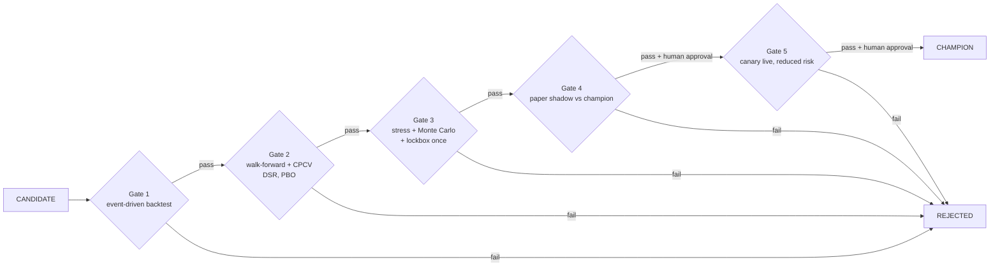

# 09 — التعلم الذاتي، تحسين الاستراتيجيات، والتحقق والترقية

## 1. ماذا يعني "التعلم الذاتي" هنا — بحدود صريحة

| المستوى | ما يتغير | كيف | الموافقة |
|---|---|---|---|
| **L0** تكيّف إحصائي | عتبات نسبية ضمن حدود معرَّفة في الإصدار (مئينات الحجم، تقديرات التقلب، عتبات الكواشف) | آلي مستمر | ضمن الإصدار المعتمد؛ أي خروج عن الحدود = تنبيه |
| **L1** أوزان العائلات (اختياري، معطّل في البداية) | توزيع ميزانية المخاطر بين عائلات الإعداد ضمن [0.5×، 1.5×] من الوزن المعتمد، بحد أقصى للتغير الأسبوعي | آلي أسبوعي بقاعدة معتمدة مع انكماش نحو الوزن الأساسي | ضمن الحدود؛ لا يتجاوز سقوف المخاطر أبداً |
| **L2** إعادة تدريب وتحسين | نماذج جديدة، معاملات استراتيجية جديدة | خط الترقية الكامل (§6) | **بشرية** للكناري والإنتاج |
| **L3** بحث جديد | ميزات/كواشف/عائلات جديدة، تغيير بنيوي | بحث بشري + خط الترقية | بشرية |
| **∞** حماية رأس المال | **لا شيء آلياً** | — | المالك البشري فقط وفق الحوكمة ([07 §10](07-risk-management.md#10-حوكمة-سياسة-المخاطر-بلا-أي-تغيير-آلي)) |

**ما لا يفعله النظام عمداً:**

- لا تعلّم متصل (Online learning) يعدّل النماذج الحية أثناء التداول.
- لا تعلّم معزّز (Reinforcement Learning) برأس مال حقيقي — ممكن كبحث دون اتصال لاحقاً فقط.
- لا نموذج لغوي في حلقة القرار.

## 2. حلقة التعلم

| الإيقاع | المهام |
|---|---|
| يومياً | توسيم نتائج أطروحات الأمس (المأخوذة والمرفوضة)، تشريح الصفقات المغلقة، تقرير جودة البيانات، فحص الانحراف |
| أسبوعياً | تقرير الأداء والإسناد، تحديث تصنيف أسباب الخسارة، تقييم الانحراف، تقرير مراجعة بشري القراءة |
| شهرياً | إعادة تحسين Walk-Forward، مقارنة Champion/Challenger، ترتيب أولويات البحث |

## 3. تشريح الصفقة (Trade Autopsy) وتصنيف الأسباب

لكل مركز مغلق:

- **المقاييس:** MAE/MFE بوحدات R، زمن بلوغ MFE، كفاءة الدخول والخروج، الانزلاق الفعلي مقابل المتوقع، التمويل والرسوم، حركة BTC أثناء الصفقة، النظام عند الدخول والخروج، أهم مساهمات الميزات عند القرار.
- **الافتراضات المضادة (Counterfactuals):** عدم الدخول، الاتجاه المعاكس، وقف أوسع/أضيق، الاحتفاظ حتى الهدف، بدون نقل الوقف للتعادل.
- **التصنيف:**

| الفئة | المعنى | ما يتعلمه النظام |
|---|---|---|
| ربح — الأطروحة صحيحة | تحقق السيناريو كما وُصف | تعزيز الثقة بالعائلة في هذا السياق |
| **ربح — حظ** | ربح رغم إبطال جزئي للأطروحة أو بسبب حركة عامة غير مرتبطة | **لا يُعتبر دليلاً على جودة القرار** |
| خسارة — الأطروحة خاطئة | السوق فعل العكس لأسباب كان يمكن رصدها | مراجعة الميزات/النموذج |
| خسارة — التوقيت | ضُرب الوقف ثم بلغ السعر الهدف ("أُوقف ثم ثبتت صحته") | معايرة مسافة الوقف/الدخول — إن تكرر بنمط ثابت |
| خسارة — التنفيذ | انزلاق/كمون فوق النموذج | نموذج التكلفة والتكتيك |
| خسارة — صدمة نظام/خبر | حدث خارجي مفاجئ | مرشحات الأحداث والنظام |
| خسارة — بيانات | قرار بُني على بيانات معيبة | **خلل يُصلح فوراً** |
| خروج بقاعدة مخاطر | أُغلق بحد خسارة/حالة مخاطر | تقييم كلفة القاعدة (دون تخفيفها آلياً) |

> **جودة القرار ≠ جودة النتيجة.** يُقيَّم القرار على توزيع نتائج قرارات مشابهة: هل القيمة المحققة على مئات القرارات تطابق `EV` المتوقع؟ (فحص المعايرة).

## 4. التوسيم وبناء مجموعات البيانات

- **توسيم بالحواجز الثلاثة (Triple Barrier)** مأخوذة من هندسة الأطروحة نفسها: الهدف، الوقف، الأفق الزمني. عند بلوغ الحاجزين في الشمعة نفسها يُحسم الترتيب من بيانات الصفقات، وإلا يُفترض **الوقف أولاً** (تحفظ).
- **توسيم كل الأطروحات** — المأخوذة والمرفوضة (`analytics.thesis_outcomes`) — لتجنب انحياز التعلم من الصفقات المنفذة فقط، ولتقييم جودة الفلاتر والمقارنة بين الاتجاهين.
- **أوزان العيّنات** حسب التفرد (التسميات المتداخلة زمنياً ليست مستقلة).
- **Point-in-Time:** ربط as-of على `available_ts`؛ كون رموز تاريخي يشمل المشطوبة؛ فلاتر العقود كما كانت (SCD2).
- **قائمة فحص التسرب:** لا ميزة تستخدم بيانات بعد `decision_ts`؛ لا تطبيع بإحصاءات من المستقبل؛ لا اختيار رموز بناءً على أدائها اللاحق؛ إحصاءات 5m تُستخدم من وقت جلبها لا من نهاية فترتها؛ لا ضبط معاملات على بيانات الاختبار.

## 5. النماذج الأولية

| النموذج | الهدف | النوع | ملاحظة |
|---|---|---|---|
| Meta-model لكل عائلة | `P(الهدف قبل الوقف خلال الأفق)` | LightGBM + Isotonic | الأساس الاحتمالي لـ `EV` |
| مصنّف مصائد الاختراق | `P(فشل الاختراق خلال H)` | LightGBM + Isotonic | الحَكَم بين S1 وS2 |
| متنبئ التقلب | التقلب للأفق | HAR-RV / GARCH / LightGBM | للوقف والأهداف وتحجيم المخاطر |
| نموذج الانزلاق والأثر | الانزلاق المتوقع لحجم معين | انحدار على تنفيذاتنا + الدفتر | يُحدَّث من TCA |
| مصنّف النظام | نظام السوق | قواعد ← HMM/GMM | يُعتمد إن حسّن القرار فعلاً |

- **عدم اليقين:** مجموعة نماذج (Bagging/بذور مختلفة) + التنبؤ المطابق ← `p_low`.
- **ثبات الأهمية:** ميزة تتقلب أهميتها بشدة بين الطيّات ← مشبوهة (غالباً ضجيج).
- **التفسير:** SHAP لكل قرار.
- التعلم العميق على الدفاتر (نماذج تسلسلية) **بحث لاحق بعتبة إثبات أعلى**.

## 6. منهجية التحقق

### 6.1 واقعية الاختبار الرجعي (قائمة إلزامية)

محرك أحداث بالكود نفسه + رسوم فعلية + انزلاق من الدفتر + كمون + تمويل بفترات كل رمز + تصفية بالشرائح + فلاتر المنصة + كون تاريخي بلا انحياز نجاة + إعادة تشغيل فجوات البيانات كما حدثت + حتمية (بذور مثبتة، بيانات وكود بإصدارات) — انظر [08 §9](08-execution.md#9-التنفيذ-المحاكى-backtestpaper).

دروس مُثبتة من [H-004](research/H-004-tsmom-point-in-time-universe.md) (إلزامية لكل اختبار):
- **الكون يُختار يوماً بيوم بما كان معروفاً وقتها**، والعملات المشطوبة داخله؛ قائمة مختارة اليوم ضخّمت Sharpe من 0.88 إلى 1.28.
- **شمعة بحجم تداول صفر = يوم بلا تداول**: الأرشيف يُبقي شموعاً وهمية ثابتة السعر بعد الشطب (حتى 560 يوماً).
- **ملفات الأرشيف الشهرية قد تكون ناقصة**: تُملأ من الملفات اليومية الرسمية، ويُفحص الاتساق قبل أي تشغيل.
- **قرار يوم d لا يرى إلا بيانات حتى إغلاق d**، حتى في شرط "هل العملة صالحة"؛ العملة التي تتوقف أثناء الاحتفاظ تخرج عند آخر سعر مع انزلاق إضافي.

### 6.2 Walk-Forward مع تطهير وحجز (Purging & Embargo)

| الطيّة | التدريب | الحجز | التحقق (ضبط المعاملات) | الاختبار (خارج العينة) |
|---|---|---|---|---|
| 1 | الأشهر 1–12 | ≥ 2× أقصى أفق احتفاظ | الشهر 13 | الشهر 14 |
| 2 | الأشهر 2–13 | كذلك | الشهر 14 | الشهر 15 |
| 3 | الأشهر 3–14 | كذلك | الشهر 15 | الشهر 16 |
| … | نافذة متدحرجة (ونسخة مرتكزة Anchored للمقارنة) | | | |

- **التطهير:** حذف عيّنات التدريب التي يتداخل أفق تسميتها مع فترة الاختبار.
- **الحجز:** فجوة بعد كل فترة اختبار قبل استخدام البيانات للتدريب.
- **التداخل (Nested):** ضبط المعاملات داخل نافذة التدريب/التحقق فقط؛ الاختبار لا يُلمس إلا للتقييم.

### 6.3 مقاومة الإفراط في الملاءمة

| الأداة | الغرض |
|---|---|
| **CPCV** (Combinatorial Purged CV) | توزيع لأداء خارج العينة بدل رقم واحد |
| **Deflated Sharpe Ratio** | تصحيح الشارب لعدد **كل** التجارب المسجلة (بما فيها الدراسات السابقة على البيانات نفسها) |
| **PBO** (احتمال الإفراط عبر CSCV) | احتمال أن "الأفضل داخل العينة" دون الوسيط خارجها |
| **ثبات المعاملات** | تغيير كل معامل ±10–20% يجب ألا ينهار الأداء؛ نختار **مركز الهضبة** لا القمة الحادة |
| **Monte Carlo** على تسلسل الصفقات | توزيع التراجعات المتوقعة (يُستخدم لاحقاً لكشف التدهور الحي) |
| **صندوق الإقفال (Lockbox)** | آخر 3 أشهر لا تُلمس أثناء التطوير؛ تُستخدم **مرة واحدة** لكل إصدار مرشح (مسجّلة في `ml.lockbox_access`)؛ الفشل فيها يعني عدم إعادة الضبط عليها |
| **تسجيل الفرضيات مسبقاً** | كل فرضية تُسجل (`ml.research_hypotheses`) قبل اختبارها مع الأثر المتوقع وخطة الاختبار |
| **تفضيل البساطة** | التعقيد الإضافي يجب أن يتفوق خارج العينة على بديل أبسط |

### 6.4 سيناريوهات الضغط الإلزامية

أيام سوق قصوى تُعاد عبر النظام كاملاً (بيانات + قرار + مخاطر + تنفيذ محاكى)، والمعيار: هل بقيت الخسارة ضمن الحدود وهل تفاعلت آلة الحالات صحيحاً؟

- 2020-03-12 (انهيار كوفيد)، 2021-05-19، 2022-06 (أزمة الإقراض)، 2022-11 (انهيار FTX)، 2024-08-05، **2025-10-10** (أكبر موجة تصفيات مسجلة في سوق العملات المشفرة).
- **ملاحظة:** الأيام التي تسبق بدء تسجيلنا الذاتي للدفاتر تُختبر بالصفقات والشموع وبيانات المشتقات المتاحة، أو ببيانات دفاتر مشتراة.
- اختبار أداء: إعادة تشغيل يوم 2025-10-10 بسرعة 5× للتحقق من صمود خط البيانات تحت العاصفة.

## 7. مُحسِّن الاستراتيجيات (Strategy Optimizer)

| البند | التصميم |
|---|---|
| ما يحسّنه | معاملات العائلات (عتبات الإعداد، هوامش الإيقاف، اختيار الأهداف، تكتيك الدخول، الإيقاف الزمني)، معاملات النماذج، اختيار مجموعات الميزات، θ وΔ **فوق** الأرضيات |
| ما لا يستطيع لمسه | أي شيء في سياسة المخاطر — مفروض بالمخطط وقاعدة البيانات وCI ([07 §10](07-risk-management.md#10-حوكمة-سياسة-المخاطر-بلا-أي-تغيير-آلي)) |
| الخوارزمية | Optuna (TPE/CMA-ES) مع إيقاف مبكر للتجارب الضعيفة |
| دالة الهدف | وسيط أداء خارج العينة عبر طيّات WF (مثل متوسط R لكل فرصة أو الشارب) − λ × تشتته عبر الطيّات − عقوبات للتراجع والتداول المفرط؛ بقيد حد أدنى من الصفقات لكل طيّة |
| ميزانية التجارب | حد أقصى للتجارب لكل دورة بحث؛ **كل** التجارب تُسجل وتدخل في حساب DSR |
| الاختيار | مركز الهضبة في فضاء المعاملات، بعد فحص الثبات |
| المخرج | `strategy_config` جديد + `release_bundle` مرشح (المرحلة CANDIDATE) — لا شيء أكثر |

## 8. خط الترقية والبوابات

| البوابة | المعايير المبدئية (تُعاير؛ تُقارن دائماً بالبطل الحالي على الفترة نفسها) |
|---|---|
| 1. Backtest | ≥ 200 صفقة لكل عائلة على ≥ 12 شهراً تغطي أنظمة مختلفة؛ Profit Factor ≥ 1.2 بعد التكاليف؛ التراجع ضمن السياسة؛ لا شهر واحد يمثل > 40% من الربح؛ لا خرق لأي قاعدة مخاطر |
| 2. WF + CPCV | وسيط الأداء خارج العينة > 0 مع ≥ 70% طيّات موجبة؛ DSR ≥ 0.95؛ PBO ≤ 0.2؛ تدهور داخل← خارج العينة ≤ 50% |
| 3. ضغط | البقاء ضمن حدود الخسارة في كل السيناريوهات مع تفاعل صحيح لآلة الحالات؛ المئين 95 لتراجع Monte Carlo ≤ حد السياسة؛ نجاح صندوق الإقفال |
| 4. ورقي | ≥ 4 أسابيع و≥ 50 قراراً؛ تطابق الورقي مع الاختبار الرجعي على الفترة نفسها (ارتباط النتائج، الانزلاق ضمن 1.5× النموذج)؛ صفر أخطاء تشغيلية؛ الأفضلية على البطل (§9) |
| 5. كناري | ≥ 30 صفقة أو 4 أسابيع بنسبة 25% من المخاطرة العادية؛ الانزلاق الحقيقي ≤ 1.5× النموذج؛ التراجع داخل النطاق المتوقع |

الانتقالات بين المراحل مفروضة في قاعدة البيانات (لا قفز فوق بوابة، والترقية إلى CANARY/CHAMPION بشرية فقط) — مُختبرة في [`governance_tests.sql`](../db/postgres/tests/governance_tests.sql).

## 9. المقارنة بين البطل والمتحدي

- **على الفترة نفسها وبيانات نفسها:** الاختبار الرجعي للفترات نفسها + التشغيل الورقي المتوازي في الزمن الحقيقي.
- **المقياس الأساسي:** متوسط R لكل فرصة قرار (أو العائد اليومي المعدّل بالمخاطرة)، مع مقاييس المخاطر (التراجع، CVaR) كقيود.
- **الإحصاء:** فروق يومية مزدوجة + **Block Bootstrap** (العوائد مترابطة زمنياً) ← فاصل ثقة 90% للفرق.
- **قاعدة الترقية:** الحد الأدنى لفاصل الثقة للفرق > 0؛ **أو** — لتغيير يُبسّط أو يصلح خللاً — عدم الدونية (الفرق ≥ −هامش صغير) دون أي تدهور في مقاييس المخاطر.
- عدم إعلان فائز مبكراً: حد أدنى للمدة وعدد القرارات قبل أي حكم.

## 10. الإصدارات والتراجع

**حزمة الإصدار (Release Bundle):** Git SHA + digest صورة الحاوية + إصدار النواة + إصدار الميزات + إعدادات العائلات + إصدارات النماذج (MLflow) + بصمة سياسة المخاطر التي تحقق تحتها + مجموعات التدريب + تقارير التحقق. **غير قابلة للتعديل** (مفروض في قاعدة البيانات)؛ ترقيم دلالي: MAJOR لعائلة/ميزات جديدة، MINOR لإعادة تدريب/معاملات، PATCH لإصلاح.

**التراجع (أمر واحد بشري):**

1. K1 — إيقاف الدخول.
2. تبديل `cfg.active_releases` إلى البطل السابق (`RETIRED → CHAMPION`).
3. إعادة تشغيل المتداول بالحزمة السابقة ← مطابقة الإقلاع.
4. المراكز المفتوحة تتبناها إدارة المراكز من الأطروحة المخزنة معها (الوقف، الأهداف، الإبطال، الإيقاف الزمني).
5. استئناف الدخول إن سمحت حالة المخاطر.

**الاستجابة الآلية لتدهور إصدار حي:** إذا تجاوز التراجع الحي المئين 99 من توزيع Monte Carlo المتوقع، أو تجاوز الانزلاق الحقيقي 2× النموذج، أو ارتفعت الأخطاء: **REDUCE_ONLY آلياً + تنبيه P1** — والتراجع نفسه قرار بشري بأمر واحد. لا تغيير آلي لمنطق التداول الحي في أي اتجاه.

## 11. مراقبة الانحراف (Drift)

| ما يُراقَب | المقياس | الأثر |
|---|---|---|
| توزيع الميزات | PSI/KS أسبوعياً (PSI > 0.2 تنبيه) | مراجعة؛ مرشح لإعادة التدريب |
| توزيع التنبؤات | تحول المتوسط والتشتت | مراجعة |
| المعايرة | Brier/ECE على النتائج الموسومة | CAUTION للعائلة إن تدهورت |
| الأداء مقابل التوقع | CUSUM على (R المحقق − EV المتوقع) | CAUTION/تعليق العائلة + مراجعة |
| التنفيذ | الانزلاق الفعلي مقابل النموذج | تصحيح النموذج؛ تشديد حدود السيولة |
